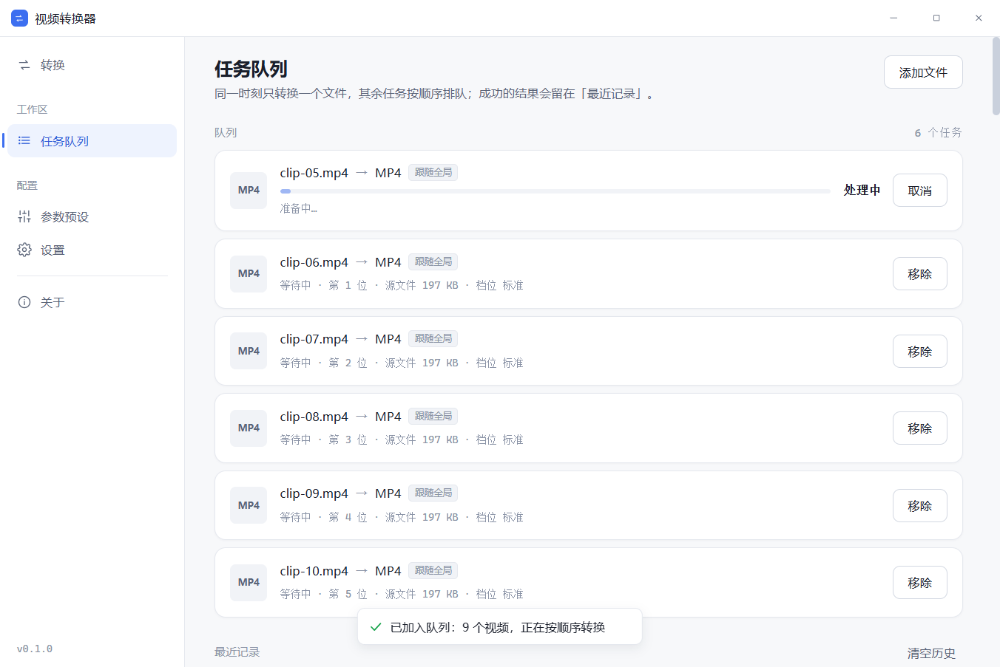

# 视频转换器（Video Converter Desktop）

[](https://github.com/Zkaixin111/video-converter-desktop/actions/workflows/ci.yml)

## 一、产品介绍

**视频转换器**是一款 Windows 桌面端的本地视频格式转换工具。把视频拖进来，选一个目标格式，剩下的交给它。


### 它解决什么问题

网上教程教你敲一行 ffmpeg 命令，但它不会告诉你**为什么你的文件转出来不能用**：有的播放器能放、有的花屏，有的根本导不进去。这款应用把 ffmpeg 藏在界面后面，专心做两件事：

1. **让它一定能用**——转完自动用 ffprobe 读回校验（时长、视频流、音轨），不通过就删掉坏文件并告诉你原因，绝不留一个「看起来转完了其实放不了」的文件；
2. **告诉你为什么之前不行**——7 类常见报错全部翻译成人话，并给出下一步建议，而不是甩一行英文堆栈。

全程离线：无服务端、无账号、无上传，文件不出本机。

### 核心亮点

- **8 种目标格式**：MP4 / MKV / AVI / MOV / FLV / WMV / WebM / MPEG；
- **能直通就直通**：源编码目标容器装得下时只换封装、不重新压缩——秒级完成、画质零损失；画面能直通但音频装不下时，只重编码音频；
- **批量队列**：一次拖入多个文件（上限 10 个/批），按顺序排队转换，等待中的任务可以拖拽调整顺序，也能随时暂停 / 继续整个队列；
- **失败不打断整批**：某个文件失败后队列继续跑剩下的，失败任务标红、可单独重试或删除；也可以设置成「失败即暂停」等你自己处理；
- **关窗继续转**：转码中关掉窗口，程序缩进系统托盘继续跑，托盘悬停能看到「3/10 · 45%」这样的进度，从托盘菜单才是真正退出；
- **崩溃恢复**：程序意外退出后，下次启动会还原没跑完的任务（先暂停等你确认），不会白转一场；
- **历史记录**：每次转换的结果（产物大小、校验结果、所在文件夹）都有台账，可一键按原参数重跑；
- **画质三档真实生效**：高清优先 / 标准 / 体积优先，三档直接决定 CRF 与码率，不是摆设。



## 二、如何使用

### 安装与启动（从源码运行）

前置要求：Windows 10/11 x64、[Node.js](https://nodejs.org/) ≥ 20 与 [pnpm](https://pnpm.io/)（`npm i -g pnpm`）。

```bash
# 1. 拉取代码
git clone git@github.com:Zkaixin111/video-converter-desktop.git
cd video-converter-desktop

# 2. 安装依赖
pnpm install

# 3. 放置 FFmpeg 引擎（二进制不入库，需手动放置一次）
#    下载 full build（必须含 libx264）：https://www.gyan.dev/ffmpeg/builds/
#    解压后把这两个文件放到：
#      resources/bin/win32-x64/ffmpeg.exe
#      resources/bin/win32-x64/ffprobe.exe

# 4. 启动
pnpm dev
```

> 启动时应用会自检引擎：缺文件或缺 libx264 会进入引导态，按提示放好再点「重新检测」即可，不影响界面打开。

### 打包成安装包（可选）

```bash
pnpm dist        # 产出 Windows NSIS 安装包到 release/<版本号>/
pnpm dist:dir    # 只要目录形态（release/<版本号>/win-unpacked/），跳过安装器，验证快
```

### 基本操作流程

1. **导入视频**：打开「转换」页，把视频文件拖进窗口任意位置（或点「选择文件」）。支持 MP4、MKV、AVI、MOV、FLV 等常见封装；一次可以选多个。
2. **选目标格式**：在格式列表里选一个输出格式（默认 MP4）。想压缩体积就到「参数预设」页把对应格式的画质档位调成「体积优先」。
3. **开始转换**：
   - 只有 1 个文件：在转换页直接看实时进度（百分比 / 倍速 / 剩余时间）；
   - 多个文件：整批交给「任务队列」页排队转换，等待中的任务可拖拽排序（或选中后按 `Alt+↑/↓`）。
4. **管理队列**：页头可以暂停 / 继续整个队列；失败的任务标红，可单独「重试」或「移除」。
5. **关掉窗口也没关系**：转码中点右上角 ×，程序缩进托盘继续跑（任务栏通知区可见图标，悬停看进度）；要彻底退出，右键托盘图标选「退出」。不想要这个行为的话，在「设置 → 崩溃与退出」里关掉「关闭窗口时最小化到托盘」即可。
6. **取结果**：转完的文件默认和源文件放在一起（文件名带 `_converted` 后缀）；也可以在「设置」里改默认保存位置，或开启「转换完成后打开所在文件夹」。每次转换都会记进队列页的「最近记录」，可随时打开文件夹或按原参数重跑。


