# 视频转换器 · 开发环境准备清单

> **核对日期**：2026-07-04（所有版本号均为当日实测查询结果，非记忆值）
> **目标平台**：Windows 10/11 x64
> **技术基线**：Electron + React + TypeScript + FFmpeg/FFprobe CLI
> **对应文档**：《需求分析文档》阶段 0 —— 工程脚手架

---

## 0. 环境现状速览（你本机实测）

先给结论：**你机器上的基础运行时已经够用，只缺两个东西——FFmpeg 工具链和包管理器。**

| 项 | 要求 | 你本机实测 | 状态 |
|---|---|---|---|
| Node.js | ≥ 22.12（Vite 8 与 Electron 44 的硬要求） | **v22.22.2** | ✅ 已满足 |
| npm | ≥ 10 | **10.9.7** | ✅ 已满足 |
| Git | 任意新版本 | **2.55.0** | ✅ 已满足 |
| VS Code | 任意 | **1.139.1** | ✅ 已满足 |
| Python | 可选（仅脚本辅助） | 3.13.14 | ✅ 有，但本项目不依赖 |
| **FFmpeg / FFprobe** | 8.1.x 或 9.0.x | **未安装** | ❌ **必须装** |
| pnpm | 可选，推荐 | **未安装** | ⚠️ 建议装 |
| Visual Studio Build Tools | **不需要** | — | ✅ 免装（见 §2.9 说明） |

> Node 22.22.2 这一点很关键：`vitest 5`、`electron-store 12`、`vite 8` 三者都卡 `>= 22.12`，你的版本正好过线。若将来重装系统，**务必装 22.x LTS 或 24.x LTS，不要降到 20**。

---

## 1. 安装顺序总览

顺序不是随意的，每一步都依赖前一步的产物：

```
① 校验 Node.js / Git / VS Code（已满足，跳过）
        ↓
② 安装 FFmpeg + FFprobe（winget），并加入 PATH
        ↓
③ 安装 pnpm（可选，但推荐）
        ↓
④ 用 electron-vite 脚手架初始化项目
        ↓
⑤ 安装依赖（分 devDependencies / dependencies 两批）
        ↓
⑥ 配置 TypeScript / ESLint / Prettier / Tailwind
        ↓
⑦ 把 ffmpeg.exe + ffprobe.exe 固化进 resources/bin（不依赖系统 PATH）
        ↓
⑧ 跑环境自检脚本，全部通过才算环境就绪
```

**为什么 ② 在 ④ 之前**：脚手架初始化后你会立刻想验证"能不能真的转码"，如果此时 FFmpeg 还没就绪，项目会在第一天就卡在一个与业务无关的环境问题上。

**为什么 ⑦ 必须单独做**：系统 PATH 里的 FFmpeg 只服务于开发；打包给用户的那份必须是**你自己锁定的版本**，否则用户机器上有没有 FFmpeg、是哪个版本，完全不可控。

---

## 2. 分类清单

### 2.1 语言运行时

| 项 | 版本 | 用途 | 状态 |
|---|---|---|---|
| **Node.js** | 22.22.2 LTS | 构建工具链运行环境；主进程开发 | ✅ 已有 |
| **TypeScript** | **5.9.3**（推荐）<br>或 7.0.2（latest） | 全项目类型系统 | 随项目安装 |

**关于 TypeScript 版本的判断（重要）**

当前 npm 上 `typescript@latest` 是 **7.0.2**，且已存在 6.0.3 过渡版本。TypeScript 7 是**用 Go 重写的原生编译器**（tsgo），编译速度有数量级提升，但它的插件生态（`typescript-eslint`、各类 Vite 插件、编辑器语言服务）在部分组合下仍有兼容差异。

**2 周工期的项目，不该在类型编译器上冒险。** 建议：

```jsonc
// package.json
"devDependencies": {
  "typescript": "5.9.3"     // 保守：最后一个纯 JS 实现稳定线
}
```

若你愿意尝鲜，把 `5.9.3` 换成 `7.0.2` 即可，其余配置无需改动。**但必须单独验证一遍 `pnpm lint` 和 `pnpm build` 都能过。**

> ⚠️ 注意运行时的双重 Node 版本：**构建时**用你本机的 Node 22，**主进程运行时**用的是 Electron 44 内置的 **Node 24.18.1**。所以主进程代码可以放心用 Node 22/24 的 API，但**不要用 Node 25+ 才有的实验性 API**。

### 2.2 包管理器

| 项 | 版本 | 用途 | 状态 |
|---|---|---|---|
| **pnpm** | 10.x | 依赖安装，硬链接节省磁盘，安装速度快 | ⚠️ 需装 |
| npm | 10.9.7 | 兜底使用（pnpm 出问题时可退回） | ✅ 已有 |

```powershell
# 安装 pnpm（任选其一）
npm install -g pnpm
# 或
winget install pnpm.pnpm
```

> **为什么推荐 pnpm 而不是 npm**：Electron 项目的 `node_modules` 动辄 800MB+，pnpm 的硬链接机制能把这个数字压到 200MB 左右，且在 Windows 上删目录快得多（npm 的深层嵌套目录经常删不掉）。**但 pnpm 装 Electron 时必须允许执行 postinstall 脚本**，否则不会下载 Electron 二进制——见 §6 常见坑。

### 2.3 外部二进制：FFmpeg / FFprobe ★最关键的一项

这是整个项目**唯一的外部运行时依赖**，也是唯一不能靠 `npm install` 解决的东西。

| 项 | 版本 | 用途 |
|---|---|---|
| **ffmpeg.exe** | **8.1.x**（推荐）或 9.0.x | 转码、抽帧、封装、滤镜 |
| **ffprobe.exe** | 与 ffmpeg 同版本 | 元数据解析、流信息、输出校验 |

**当前 FFmpeg 版本现状（2026-07-04 官方数据）**

| 分支 | 最新补丁版 | 发布日期 | 建议 |
|---|---|---|---|
| 9.0 | 9.0.2 | 2026-09-18 | 可选，主分支较新 |
| **8.1** | **8.1.3** | 2026-09-21 | ✅ **推荐**：分支成熟、补丁齐全 |
| 8.0 | 8.0.3 | 2026-06-18 | 可选 |
| 7.1 | 7.1.5 | 2026-06-20 | 够用但偏旧 |

**本项目的功能需求（H.264 / HEVC / AV1 / VP9 编解码，scale / pad / boxblur 滤镜，Remux）在 7.x 就已全部具备**，选 8.1 是为了拿到更好的硬件加速与 AV1 支持，不必追 9.0。

**必须选 GPL 构建版本**，原因：默认的 LGPL 构建**不含 libx264 / libx265**，而这是本项目输出 MP4/MKV 的主力编码器。没有它，`-c:v libx264` 会直接报 `Unknown encoder`。

**安装方式（推荐 winget）：**

```powershell
# 方式一：winget（推荐，自动进 PATH）
winget search ffmpeg
winget install Gyan.FFmpeg
# 若上面包名不存在，试：
winget install "FFmpeg (Essentials Build)"
```

```powershell
# 方式二：手动下载（可控性最高）
# 从 https://www.gyan.dev/ffmpeg/builds/ 下载 "ffmpeg-release-full.7z"
# 解压后把 bin/ 目录加入系统 PATH
```

**验证安装：**

```powershell
ffmpeg -version
ffprobe -version
ffmpeg -encoders | Select-String "libx264|libx265|libvpx-vp9|libsvtav1"
ffmpeg -hwaccels
```

必须看到 `libx264`、`libx265` 出现在输出里。**如果只有 `h264_nvenc` 这类硬件编码器而没有 `libx264`，说明装成了精简版，必须重装 full 版。**

**⑦ 号步骤（固化进项目）的正确做法：**

```
项目根/
└── resources/
    └── bin/
        └── win32-x64/
            ├── ffmpeg.exe
            ├── ffprobe.exe
            └── VERSION.txt     ← 必须写：版本号 + 下载来源 + 下载日期
```

`VERSION.txt` 示例内容：
```
FFmpeg 8.1.3 (GPL full build)
Source: https://www.gyan.dev/ffmpeg/builds/ffmpeg-release-full.7z
Downloaded: 2026-07-04
SHA256(ffmpeg.exe): <填实际值>
```

> **这不是形式主义**。三个月后你要打包发版时，必须能回答"用户装到的到底是哪个 ffmpeg"——尤其是遇到某个格式转失败时，版本是第一排查项。

### 2.4 桌面框架与构建链

| 包 | 版本 | 用途 |
|---|---|---|
| **electron** | **44.9.0** | 桌面运行时（Chromium 152 / Node 24.18.1） |
| **electron-vite** | **6.0.0** | 主进程 / 预加载 / 渲染进程三端统一构建与 HMR |
| **electron-builder** | **26.15.3** | 产出 Windows NSIS 安装包、代码签名、自动更新元数据 |
| **vite** | **8.3.4** | 前端打包器（electron-vite 6 的底层） |
| **@vitejs/plugin-react** | **6.1.2** | React 的 Vite 插件（peer 要求 vite ^8） |

**⚠️ Electron 版本必须修正**

前一份《需求分析文档》里写的 **Electron 30** 是错的——30 已于 **2024-10-14 停止支持（EOL）**，用它意味着两年多的 Chromium 安全补丁全部缺失，且打包时 Electron 官方下载源对 EOL 版本的支持会逐步收窄。

当前 Electron 支持窗口（官方 Release Schedule）：

| 版本 | 稳定版发布 | EOL | 状态 | 建议 |
|---|---|---|---|---|
| 45 | 2026-07-06（两天后） | 2027-04-27 | prerelease | ❌ 太新，初期有 bug |
| **44** | **2026-08-25** | **2027-03-02** | **维护中** | ✅ **选它** |
| 43 | 2026-06-30 | 2027-01-05 | 维护中 | 可选 |
| 42 | 2026-05-05 | 2026-07-06（后天！） | 即将 EOL | ❌ 不要用 |

**结论：锁 `electron@44.9.0`。** 它有 5 个月支持期，够覆盖 MVP 到 V1.0 的整个周期。

**electron-vite vs 手写 Vite 配置**

| 方案 | 优势 | 劣势 |
|---|---|---|
| **electron-vite**（推荐） | 三端配置开箱即用、主进程热重载、内置 `externalizeDepsPlugin` | 多一层抽象，配置项要看文档 |
| 手写 Vite + 自定义脚本 | 完全可控 | 三端构建 + 开发时主进程重启，至少要花 1-2 天调 |

2 周工期，**用 electron-vite**。

### 2.5 前端框架与 UI

| 包 | 版本 | 用途 |
|---|---|---|
| **react** | **19.3.1** | UI 框架 |
| **react-dom** | **19.3.1** | DOM 渲染 |
| **zustand** | **5.0.15** | 轻量状态管理（任务列表、当前进度） |
| **tailwindcss** | **4.3.3** | 原子化 CSS |
| **@tailwindcss/vite** | 4.3.x | Tailwind 4 的 Vite 插件（v4 不再用 PostCSS 配置） |
| lucide-react | 最新 | 图标（可选，体积小、风格统一） |

**关于 React 19**：`useActionState`、`useOptimistic`、`ref` 作为普通 prop 这些新特性对本项目帮助不大，但也没有迁移成本（新项目从零开始）。用 19 即可，不要退回 18。

**关于 Tailwind 4**：安装方式与 v3 完全不同，**没有 `tailwind.config.js`，也不需要 PostCSS**。正确姿势：

```ts
// vite.config.ts（renderer 部分）
import tailwindcss from '@tailwindcss/vite'
export default defineConfig({
  plugins: [react(), tailwindcss()],
})
```

```css
/* src/renderer/src/assets/main.css */
@import "tailwindcss";
```

> **状态管理为什么选 zustand**：本项目只有"文件信息 + 转码进度 + 任务队列"三块状态，Redux 过重，Context 会导致高频进度更新引发全树重渲染。zustand 的 selector 订阅能让进度条只更新它自己。
>
> **但更重要的架构原则**：**转码任务的真实状态在主进程**，渲染层只是一个订阅者。不要试图把 ffmpeg 子进程状态"同步"到前端 store 里再反向控制——那样一定会出现状态不一致。

### 2.6 工程化与质量保障

| 包 | 版本 | 用途 | MVP 是否必需 |
|---|---|---|---|
| **vitest** | **5.0.5** | 单元测试，重点测 `planConversion()` | ✅ 强烈建议 |
| **eslint** | **10.13.0** | 代码检查 | ✅ |
| **prettier** | **3.9.10** | 格式化 | ✅ |
| typescript-eslint | 最新 | ESLint 的 TS 支持 | ✅ |
| eslint-plugin-react-hooks | 最新 | Hook 依赖检查 | ✅ |
| **electron-store** | **12.0.0** | 本地配置持久化（窗口尺寸、上次输出目录） | ✅ |
| electron-updater | 6.8.9 | 自动更新 | ❌ P3 才用 |
| @electron-toolkit/utils | 4.0.0 | 主进程常用封装（可选） | ⭕ 可选 |
| @electron-toolkit/preload | 3.0.2 | 预加载脚本封装（可选） | ⭕ 可选 |

**测试策略（只测一处，但必须测）**

不需要给 UI 写测试。**只需要给 `planConversion()` 写单元测试**——它是纯函数，输入源元数据 + 目标格式，输出 ffmpeg 参数数组与模式标签。它覆盖了全项目最容易出 bug 的逻辑（容器编码兼容判定），一个 `it.each` 就能跑完 8 容器 × 4 源编码的矩阵。

### 2.7 数据库与中间件

**本项目 MVP 阶段：完全不需要数据库，也不需要任何中间件。**

这一条要说清楚，因为它和多数"环境清单"的默认假设不同：

| 常见项 | 本项目是否需要 | 原因 |
|---|---|---|
| MySQL / PostgreSQL | ❌ 不需要 | 纯本地工具，无服务端，无多用户 |
| Redis | ❌ 不需要 | 无缓存需求，无分布式 |
| SQLite | ❌ MVP 不需要 | 唯一要持久化的是"窗口尺寸、上次输出目录"这类几 KB 的配置 |
| 消息队列（RabbitMQ / Kafka） | ❌ 不需要 | 任务队列在进程内，单机串行/小并发 |
| Nginx / 反向代理 | ❌ 不需要 | 无 HTTP 服务 |
| Docker | ❌ 不需要 | 桌面应用，不是服务端部署 |

**替代方案：`electron-store 12.0.0`**

它就是一个带 schema 校验和原子写入的 JSON 文件（存在 `%APPDATA%/<app-name>/config.json`）。对配置类数据完全够用，且**零外部依赖、跨平台、不需要起服务**。

**什么时候才需要引入真正的数据库（明确边界，防止过度设计）**：

| 触发条件 | 才考虑 | 方案 |
|---|---|---|
| 需要保存历史转换记录（几百条以上，要搜索/统计） | P2 之后 | `better-sqlite3`（同步 API，主进程用很合适） |
| 需要多端同步任务状态 | 不在规划内 | 那已经是另一款产品了 |

> ⚠️ 如果将来确实要装 `better-sqlite3`，它会触发 **node-gyp 原生编译**，届时才需要装 Visual Studio Build Tools（C++ 工作负载）。**MVP 阶段不要装**，白占 6GB 磁盘。

### 2.8 开发工具

| 工具 | 版本 | 用途 | 状态 |
|---|---|---|---|
| **VS Code** | 1.139.1 | 主编辑器 | ✅ 已有 |
| **Git** | 2.55.0 | 版本控制 | ✅ 已有 |
| Windows Terminal | 任意 | 多标签终端（可选） | ⭕ |
| **Process Explorer** | 最新 | **排查孤儿 ffmpeg 进程的必备工具** | ⭐ 推荐 |
| 7-Zip | 最新 | 解压 ffmpeg 的 .7z 包、检查安装包内容 | ⭐ 推荐 |
| Everything | 最新 | 秒搜文件（调试输出目录） | ⭕ |

**VS Code 必装插件：**

| 插件 | 用途 |
|---|---|
| ESLint | 内联显示 lint 错误 |
| Prettier - Code formatter | 保存自动格式化 |
| Error Lens | 错误直接显示在代码行尾，不用悬停 |
| Tailwind CSS IntelliSense | 类名补全 |
| EditorConfig for VS Code | 统一缩进/换行符 |

**为什么特别推荐 Process Explorer**：本项目 M-04 要求"取消后 1 秒内进程消失，无孤儿进程"。在 Windows 上 `child_process.kill()` 对 ffmpeg 子进程**经常杀不干净**（尤其是没有 `windowsHide` 或用了 shell 时）。用 Process Explorer 的进程树视图能一眼看出 `ffmpeg.exe` 是否还挂在 Electron 下面。任务管理器看不到这层父子关系。

### 2.9 后置项（MVP 不需要，别提前装）

| 项 | 何时需要 | 成本 |
|---|---|---|
| Visual Studio Build Tools（C++ 工作负载） | 装 `better-sqlite3` 等原生模块时 | 6-8GB 磁盘 |
| 代码签名证书（EV / OV） | 准备正式分发时 | ￥1000-3000/年 |
| Apple Developer 账号 | 做 macOS 版时 | $99/年 |
| GitHub Actions / CI | 有稳定分支后 | 免费额度够用 |
| Docker Desktop | 永远不需要 | — |

---

## 3. 分步安装指南（可直接复制执行）

### Step 1 · 校验已有环境

```powershell
node -v      # 期望 v22.x 或 v24.x
npm -v       # 期望 10.x+
git --version
code -v
```

任何一项报"不是内部或外部命令"，先解决 PATH 再往下走。

### Step 2 · 安装 FFmpeg + FFprobe

```powershell
winget install Gyan.FFmpeg
```

装完**必须新开一个终端窗口**（PATH 变更不会刷新已打开的终端），然后：

```powershell
ffmpeg -version
ffprobe -version
ffmpeg -encoders | Select-String "libx264|libx265"
```

看到 `libx264` 才算成功。

### Step 3 · 安装 pnpm

```powershell
npm install -g pnpm
pnpm -v
```

### Step 4 · 初始化项目

```powershell
# 在项目根目录（C:\Users\29486\WorkBuddy\VideoTranscoder）执行
pnpm create @quick-start/electron@latest . --template react-ts
```

交互项按需填写；`--template react-ts` 会生成 React + TypeScript 的 electron-vite 工程骨架。

```powershell
pnpm install
pnpm dev          # 此时应能弹出一个空白 Electron 窗口
```

**这一步先验证窗口能起来，再往下装任何东西。** 起不来就说明 Node/Electron 的 postinstall 有问题，越早发现越好。

### Step 5 · 安装业务依赖

```powershell
# 运行时依赖
pnpm add zustand electron-store

# 开发依赖
pnpm add -D tailwindcss @tailwindcss/vite vitest @vitest/coverage-v8
pnpm add -D eslint prettier typescript-eslint eslint-plugin-react-hooks
pnpm add -D @types/node
```

### Step 6 · 固化 FFmpeg 二进制

```powershell
# 建目录
New-Item -ItemType Directory -Force -Path resources\bin\win32-x64

# 从系统 PATH 复制（或从解压目录复制）
Copy-Item (Get-Command ffmpeg).Source  resources\bin\win32-x64\ffmpeg.exe
Copy-Item (Get-Command ffprobe).Source resources\bin\win32-x64\ffprobe.exe

# 记录版本
ffmpeg -version | Select-Object -First 1 | Out-File resources\bin\win32-x64\VERSION.txt
```

然后在 `electron-builder.yml` 里确保二进制**不被压进 asar**：

```yaml
asar: true
asarUnpack:
  - resources/bin/**
extraResources:
  - from: resources/bin
    to: bin
```

> **为什么必须 `asarUnpack`**：asar 是一个打包归档文件，里面的 `.exe` **无法被 spawn 直接执行**（Windows 需要一个真实的文件路径）。这是 Electron 项目调外部二进制最常见的翻车点，表现是开发态正常、打包后报 `ENOENT`。

### Step 7 · 跑自检

```powershell
# 见 §5 的脚本，或直接执行项目里的 scripts\check-env.ps1
pwsh -File scripts\check-env.ps1
```

### Step 8 · 第一个冒烟测试

```powershell
# 用一条命令确认整条链路可用（找一个真实视频替换 input.mp4）
ffmpeg -y -i input.mp4 -c copy -movflags +faststart out.mp4
```

---

## 4. 依赖版本锁定策略

**不要用 `^` 和 `~` 通配符。** 这个项目的依赖数量不多，全部精确锁定，避免"别人的机器上装出来是另一个版本"。

```jsonc
{
  "name": "video-converter",
  "version": "0.1.0",
  "private": true,
  "engines": {
    "node": ">=22.12.0"
  },
  "dependencies": {
    "electron-store": "12.0.0",
    "zustand": "5.0.15"
  },
  "devDependencies": {
    "electron": "44.9.0",
    "electron-builder": "26.15.3",
    "electron-vite": "6.0.0",
    "vite": "8.3.4",
    "@vitejs/plugin-react": "6.1.2",
    "react": "19.3.1",
    "react-dom": "19.3.1",
    "typescript": "5.9.3",
    "vitest": "5.0.5",
    "eslint": "10.13.0",
    "prettier": "3.9.10",
    "tailwindcss": "4.3.3",
    "@tailwindcss/vite": "4.3.3"
  }
}
```

**锁定原则：**

| 依赖 | 策略 | 理由 |
|---|---|---|
| electron | 精确锁 + `pnpm.overrides` | 大版本升级 = Chromium 升级 = 潜在行为变更 |
| react / react-dom | 精确锁 | 两者版本必须严格一致 |
| vite / electron-vite | 精确锁 | 两者有 peer 依赖关系，错配会构建失败 |
| typescript | 精确锁 | 编译器行为变化可能让旧代码报新错 |
| 其他 | 精确锁 | 项目小，没有"自动拿安全补丁"的必要 |

**额外加一条 `pnpm.overrides` 防止 Electron 被间接升级：**

```jsonc
"pnpm": {
  "overrides": {
    "electron": "44.9.0"
  }
}
```

---

## 5. 环境自检脚本

已生成 `scripts/check-env.ps1`，直接运行：

```powershell
pwsh -File scripts\check-env.ps1
```

脚本检查 8 项：Node 版本、npm、pnpm、Git、ffmpeg、ffprobe、libx264/libx265 编码器、项目内固化二进制。全部通过才输出 `ENV READY`。

---

## 6. 常见坑（Windows 专属，按踩坑概率排序）

| # | 坑 | 表现 | 解法 |
|---|---|---|---|
| 1 | **pnpm 装 Electron 没下载二进制** | `pnpm dev` 报 `Electron failed to install correctly` | 项目根建 `.npmrc`，加 `node-linker=hoisted` 或 `shamefully-hoist=true`；或执行 `node node_modules/electron/install.js` |
| 2 | **asar 里的 exe 无法执行** | 开发正常，打包后 `spawn ENOENT` | `asarUnpack: resources/bin/**`，并用 `process.resourcesPath` 拼路径 |
| 3 | **中文路径 / 空格路径** | ffmpeg 报找不到文件，或参数被截断 | **永远用参数数组 + `shell: false`**，绝不拼字符串 |
| 4 | **杀软实时扫描拖慢转码** | 转 1GB 文件比预期慢 3 倍 | 把输出目录加入 Defender 排除项（仅开发机） |
| 5 | **`child_process.kill()` 杀不掉 ffmpeg** | 取消后 ffmpeg.exe 仍在跑，CPU 占满 | Windows 上用 `taskkill /PID <pid> /T /F`，或 spawn 时设 `detached: false` 并用进程树杀 |
| 6 | **长路径限制（260 字符）** | 深层目录 + 长文件名导致写入失败 | 启用 Windows 长路径支持，或在代码里检测路径长度 |
| 7 | **winget 装完 ffmpeg 但终端里找不到** | `ffmpeg : 无法将...识别为 cmdlet` | PATH 变更不刷新已开终端，**新开窗口** |
| 8 | **安装的是 LGPL 精简版 ffmpeg** | `Unknown encoder 'libx264'` | 重装 full/GPL 版本，验证 `ffmpeg -encoders` 输出 |

---

## 7. 对《需求分析文档》的版本修正

本节记录本次核对后必须同步回主文档的改动（已同步）：

| 项 | 原文档写的 | 实际应为 | 原因 |
|---|---|---|---|
| Electron | 30.x | **44.9.0** | 30 已于 2024-10-14 EOL，缺失两年安全补丁 |
| React | 18 | **19.3.1** | 当前稳定版 |
| TypeScript | 5 | **5.9.3**（或 7.0.2） | 明确到补丁号，避免装到 7.x 踩生态坑 |
| Tailwind | 未写版本 | **4.3.3** | v4 安装方式与 v3 完全不同（无 config 文件） |
| FFmpeg | 未写版本 | **8.1.3 GPL full** | 必须 GPL 版才有 libx264/libx265 |

---

## 附：一张图看清依赖关系

```mermaid
flowchart TD
    subgraph OS["操作系统层（Windows 10/11 x64）"]
        NODE["Node.js 22.22.2"]
        GIT["Git 2.55"]
        FF["ffmpeg.exe / ffprobe.exe 8.1.x<br/>（系统 PATH，仅开发用）"]
    end

    subgraph BUILD["构建链路"]
        PNPM["pnpm 10"]
        EV["electron-vite 6.0.0"]
        VITE["vite 8.3.4"]
        TS["TypeScript 5.9.3"]
        EB["electron-builder 26.15.3"]
    end

    subgraph RUNTIME["应用运行时"]
        ELE["electron 44.9.0<br/>Chromium 152 / Node 24.18"]
        REACT["react 19.3.1"]
        ZUS["zustand 5.0.15"]
        ES["electron-store 12.0.0"]
        TW["tailwindcss 4.3.3"]
    end

    subgraph APP["业务核心"]
        PLAN["planConversion() 纯函数<br/>（容器编码兼容判定）"]
        SPAWN["child_process.spawn<br/>ffmpeg 子进程"]
        FFX["resources/bin/win32-x64/<br/>ffmpeg.exe + ffprobe.exe<br/>（随包分发，锁定版本）"]
    end

    NODE --> PNPM
    PNPM --> EV
    EV --> VITE
    EV --> TS
    EV --> EB
    EB --> ELE
    ELE --> REACT
    ELE --> ZUS
    ELE --> ES
    REACT --> TW
    PLAN --> SPAWN
    SPAWN --> FFX
    FF -.->|"开发期参考版本"| FFX
    ELE --> PLAN
    EB -->|"打包时复制"| FFX
```



---

**清单结束。按 §3 的 8 个步骤走，大约 30 分钟可以把环境全部就绪。**
