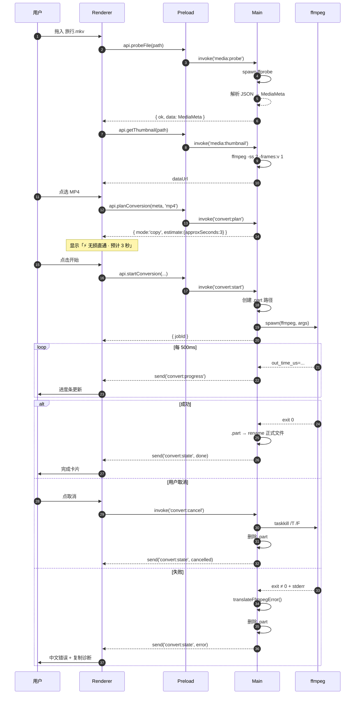

# 视频转换器 · 方案设计文档

> **文档版本**：v1.0
> **编制日期**：2026-07-04
> **对应需求**：《需求分析文档》v1.0 · MVP 阶段 M-01 ~ M-06
> **技术基线**：Electron 44.9.0 + React 19.3.1 + TypeScript 5.9.3 + FFmpeg 8.1.3
> **本文档回答三个问题**：怎么做（架构）、按什么顺序做（流程）、怎么算做对了（验收）

---

## 目录

- [0. 一页纸总览](#0-一页纸总览)
- [1. 技术选型与决策](#1-技术选型与决策)
- [2. 总体架构](#2-总体架构)
- [3. 核心模块设计](#3-核心模块设计)
- [4. 关键技术方案](#4-关键技术方案)
- [5. 工程目录结构](#5-工程目录结构)
- [6. 开发流程与实施步骤](#6-开发流程与实施步骤)
- [7. 质量保障](#7-质量保障)
- [8. 打包与分发](#8-打包与分发)
- [9. 风险登记与应对](#9-风险登记与应对)
- [10. 附录](#10-附录)

---

## 0. 一页纸总览

### 0.1 要建的东西

一个 Windows 桌面应用。用户拖进一个视频，看到它的真实信息，选一个目标格式，得到一个确定能用的文件，并且**在开始转之前就知道会发生什么**（是秒级的无损换壳，还是需要几分钟的重编码）。

### 0.2 架构一句话

> **渲染进程是纯展示层，主进程是唯一真源；所有"聪明"的逻辑收敛到 3 个纯函数里，其余都是管道。**

### 0.3 三个核心资产

| 资产 | 位置 | 为什么重要 |
|---|---|---|
| **`planConversion()` 纯函数** | `src/main/core/ffmpeg/planner.ts` | 全项目唯一有"智慧"的地方。输入源信息+目标格式，输出 ffmpeg 参数与执行模式。可单测、可复用到 Tauri、出 bug 只会出在这里 |
| **容器-编码兼容矩阵** | `src/main/core/ffmpeg/containers.ts` | 直通判定的数据基础。一张表决定了 90% 的用户体验 |
| **错误翻译规则表** | `src/main/core/ffmpeg/errors.ts` | 把 `moov atom not found` 变成人话。决定口碑 |

### 0.4 已确认的 4 个决策（本轮）

| 决策 | 选择 | 影响 |
|---|---|---|
| FFmpeg 分发 | **随安装包分发**（+80MB） | 用户零摩擦；需在关于页声明 GPL + 提供源码获取方式 |
| UI 组件 | **Tailwind 4 + shadcn/ui** | 组件源码进项目，可改；开发速度快 |
| 分发形态 | **NSIS 安装包** | 支持 P1-07 右键菜单；必须买代码签名证书 |
| 首版范围 | **完整 M-01~M-06，8 容器全支持** | 约 10 个工作日 |

### 0.5 一个必须提前知道的数字

**56**。8 种容器两两互转 = 8×7 = 56 种组合。这不是"理论上要考虑"的数字，是**验收时必须逐个跑一遍**的数字。方案里所有关于"矩阵"、"表驱动"的设计，都是为了让你能用一张表覆盖这 56 种情况，而不是写 56 个 if。

---

## 1. 技术选型与决策

### 1.1 选型总表

| 层 | 选型 | 版本 | 一句话理由 |
|---|---|---|---|
| 桌面运行时 | **Electron** | 44.9.0 | 一套 TS 打通三进程，MVP 工期优先 |
| 构建 | **vite + vite-plugin-electron** | 8.3.4 / 1.1.2 | 由 create-electron-vite 0.7.1 脚手架生成，主进程热重载 + 渲染层 HMR |
| 前端框架 | **React** | 19.3.1 | 生态成熟，shadcn 依赖它 |
| 语言 | **TypeScript** | 5.9.3 | 弃 7.x：原生编译器生态适配未稳，2 周工期不冒险 |
| 样式 | **Tailwind CSS** | 4.3.3 | v4 无需 config 文件，用 `@tailwindcss/vite` |
| 组件 | **shadcn/ui** | latest | 源码复制进项目，无运行时依赖，风格可控 |
| 状态 | **Zustand** | 5.0.15 | 高频进度更新下，selector 订阅能避免全树重渲染 |
| 持久化 | **electron-store** | 12.0.0 | 只存几 KB 配置，不需要数据库 |
| 打包 | **electron-builder** | 26.15.3 | NSIS 产出成熟，支持 asarUnpack |
| 测试 | **Vitest** | 5.0.5 | 与 Vite 同源，零额外配置 |
| 转码引擎 | **FFmpeg** | 8.1.3 GPL full | 必须 GPL 版才有 libx264/libx265 |

### 1.2 关键决策记录（ADR）

#### ADR-001：为什么不用 `fluent-ffmpeg`

| 维度 | fluent-ffmpeg | 原生 `child_process.spawn`（采用） |
|---|---|---|
| 维护状态 | 长期停更，issue 堆积 | Node 内置，无维护风险 |
| 进度获取 | 包装层解析 stderr 文本 | 可直接用 `-progress pipe:1` 拿结构化输出 |
| 参数可控性 | 有抽象层，某些参数要 escape 绕 | 完全可控，数组直传 |
| 调试难度 | 出问题要看两层 | 命令就是日志，可直接复制到终端复现 |
| 依赖体积 | +1 层依赖 | 0 |

**结论：不用。** 这不是"造轮子"，而是 `spawn` 本身就是 20 行代码的事，加一层抽象只会让问题更难查。

#### ADR-002：为什么状态放主进程而不是前端

渲染进程在转换过程中可能被重绘、被切走、甚至被用户关掉再打开。如果任务状态存在前端 store 里：

- 窗口刷新 → 状态丢失 → 用户以为任务没了（实际 ffmpeg 还在跑）
- 前端需要"反向控制"主进程 → IPC 变成双向同步 → 必然出现状态不一致

**方案**：主进程维护唯一的 `JobManager`，渲染进程通过 `invoke` 查询 + 订阅事件。渲染层的 zustand 只是一个**缓存镜像**，随时可以从主进程重新拉取。

#### ADR-003：为什么 planner 必须是纯函数

三条硬约束：

1. **可单测**：56 种组合用 `it.each` 一次跑完，不需要真的转码
2. **可迁移**：若将来换 Tauri，这个文件原样搬走（需求文档已定为硬约束）
3. **可在 UI 上预演**：用户点选目标格式后，界面立刻显示"将执行：无损直通 / 预计 3 秒"。这个"预告"本身就是产品差异点——而它要求规划过程必须是同步的、无副作用的

**纯函数的定义（严格执行）**：不读文件、不起进程、不读全局配置、不调 `Date.now()`。所有外部信息都通过参数传入。

#### ADR-004：为什么不用 ffmpeg.wasm

| | ffmpeg.wasm | 原生 ffmpeg.exe |
|---|---|---|
| 文件大小上限 | 受 wasm 堆内存限制，2GB 级就崩 | 流式处理，无上限 |
| 速度 | 单线程，慢 3-5 倍 | 多线程 + 硬件加速 |
| 稳定性 | 大文件必崩 | 稳定 |

本项目要处理 1GB+ 的视频，wasm 路线直接排除。

#### ADR-005：为什么 MVP 不暴露编码参数

竞品的参数面板是"专业感"的来源，也是小白放弃的原因。本项目的差异点是**替用户做决定**，所以 MVP 阶段：

- 不暴露 CRF / preset / profile / pixel format
- 只暴露"输出格式"这一个决策点
- 高级参数折叠在 P2 的"专业模式"里

**代价**：专业用户会觉得"太简单"。这是有意的取舍——那部分用户本来就不是目标客群。

---

## 2. 总体架构

### 2.1 进程模型

```
┌──────────────────────────────────────────────────────────────┐
│  Renderer Process (Chromium)                                  │
│  React 19 + Tailwind 4 + shadcn/ui + Zustand                 │
│  ─────────────────────────────────────────────────────────   │
│  只做三件事：渲染、收集用户意图、显示状态                       │
│  ❌ 无 Node 权限  ❌ 不碰文件系统  ❌ 不碰子进程                  │
└───────────────────────────┬──────────────────────────────────┘
                            │  contextBridge 白名单 API
                            │  （invoke 请求-响应 / on 单向推送）
┌───────────────────────────▼──────────────────────────────────┐
│  Preload Script (隔离上下文)                                  │
│  window.api = { probeFile, planConversion, startConversion,  │
│                 cancelConversion, onProgress, onStateChange,  │
│                 openOutputFolder, selectOutputDir, ... }      │
│  ─────────────────────────────────────────────────────────   │
│  只做转发，不含任何业务逻辑                                     │
└───────────────────────────┬──────────────────────────────────┘
                            │  ipcMain.handle / webContents.send
┌───────────────────────────▼──────────────────────────────────┐
│  Main Process (Node 24)  ★ 唯一真源                            │
│                                                               │
│  ┌─────────────┬──────────────┬──────────────┬─────────────┐ │
│  │ IPC Layer   │ JobManager   │ FFmpeg Layer │ Storage     │ │
│  │ 参数校验     │ 任务状态机    │ probe        │ electron-   │ │
│  │ 错误包装     │ 单任务调度    │ planner ★    │ store       │ │
│  │             │ 取消/清理     │ runner       │             │ │
│  │             │              │ errors       │             │ │
│  └─────────────┴──────────────┴──────────────┴─────────────┘ │
└───────────────────────────┬──────────────────────────────────┘
                            │  child_process.spawn（参数数组）
                  ┌─────────┴─────────┐
                  ▼                   ▼
           ┌────────────┐      ┌────────────┐
           │ ffmpeg.exe │      │ ffprobe.exe│
           │  -progress │      │  -print_   │
           │  pipe:1    │      │  format json│
           └────────────┘      └────────────┘
```

### 2.2 分层职责（严格边界）

| 层 | 可以做 | 绝对不可以做 |
|---|---|---|
| **Renderer** | 渲染、表单、动画、本地 UI 状态 | 读文件、拼 ffmpeg 命令、判断格式兼容性 |
| **Preload** | 转发调用、暴露白名单 | 任何 if/else 业务判断 |
| **Main / IPC** | 参数校验、调用下层、包装错误 | 拼 ffmpeg 参数（那是 planner 的事） |
| **Main / planner** | 纯逻辑计算 | 读写文件、起进程、读配置 |
| **Main / runner** | 起进程、解析进度、杀进程 | 决定"要不要转"（那是 planner 的事） |
| **Main / JobManager** | 状态流转、生命周期 | 关心 UI 长什么样 |

> **一条判定标准**：如果你发现自己在一个文件里既判断"能不能直通"又"启动进程"，说明分层被破坏了。

### 2.3 数据流：一次完整的转换

```
① 用户拖入文件
   Renderer → invoke('media:probe', path)
                        ↓
② Main: ffprobe -print_format json → MediaMeta
   （同时异步发起缩略图任务）
                        ↓
③ Renderer 渲染 MediaCard（缩略图 + 8 个字段）
                        ↓
④ 用户点选「MP4」
   Renderer → invoke('convert:plan', { meta, target: 'mp4' })
                        ↓
⑤ Main: planConversion(meta, 'mp4', caps) → PlanResult
   { mode: 'copy', args: [...], warnings: [...] }
                        ↓
⑥ Renderer 显示标签「⚡ 无损直通 · 预计 3 秒 · 画质 100% 保留」
                        ↓
⑦ 用户点「开始转换」
   Renderer → invoke('convert:start', { planId })
                        ↓
⑧ Main / JobManager:
   - 创建 .part 临时路径
   - spawn ffmpeg（planner 给的 args + -progress pipe:1）
   - 状态机 idle → preparing → running
                        ↓
⑨ 每 500ms：main → webContents.send('convert:progress', { pct, speed, eta })
                        ↓
⑩ ffmpeg 退出码 0
    - .part → 原子 rename 为正式文件
    - 状态机 running → done
    - send('convert:state', { status: 'done', result: {...} })
                        ↓
⑪ Renderer 显示 ResultCard（体积对比 / 耗时 / 打开目录）
```

### 2.4 状态机

**任务状态（主进程持有）**

```
                    ┌──────────────────────────────────┐
                    ▼                                  │
  idle ──probe──> probing ──ok──> ready ──plan──> planned
    ▲                │                                  │
    │              fail                              start
    │                ▼                                  │
    │             error                                 ▼
    │                                          preparing
    │                                               │
    │                                         spawn ok
    │                                               ▼
    │                                            running
    │                                          ╱    │    ╲
    │                                       cancel  ok   fail
    │                                          │     │     │
    │                                          ▼     ▼     ▼
    └──────────────────────────────────── cancelled  done  error
```

**关键规则**

| 规则 | 说明 |
|---|---|
| 状态只能单向推进（除 error/cancelled 可回 idle） | 禁止 done → running 这种回退 |
| `running` 状态下禁止再次 `start` | IPC 层直接拒绝，返回 `E_BUSY` |
| `cancel` 在 `preparing` 阶段也要生效 | ffmpeg 可能已 spawn 但还没输出进度 |
| 进入 `done` 前必须完成文件 rename | 状态先变、文件后到 = 用户看到"完成"但文件夹里没有 |
| 任何 `error` / `cancelled` 都必须清理 `.part` | 放在 `finally` 里，不依赖调用方 |

### 2.5 IPC 通道设计

**请求-响应型（`invoke`）**

| 通道 | 入参 | 出参 | 说明 |
|---|---|---|---|
| `media:probe` | `{ path }` | `MediaMeta` | 解析元数据，≤500ms |
| `media:thumbnail` | `{ path, atSec? }` | `{ dataUrl }` | 抽帧，返回 base64 或自定义协议 URL |
| `convert:plan` | `{ meta, target }` | `PlanResult` | 纯计算，同步返回 |
| `convert:start` | `{ meta, target, outputDir? }` | `{ jobId }` | 启动任务 |
| `convert:cancel` | `{ jobId }` | `{ ok }` | 取消 |
| `convert:status` | — | `JobSnapshot` | 供渲染层崩溃恢复后拉取 |
| `shell:openFolder` | `{ path }` | `{ ok }` | 打开输出目录 |
| `dialog:selectOutputDir` | — | `{ path \| null }` | 选目录 |
| `app:capabilities` | — | `{ ffmpeg: {...} }` | 启动自检结果 |

**推送型（`on`）**

| 事件 | 载荷 | 频率 |
|---|---|---|
| `convert:progress` | `{ jobId, pct, speed, etaSec, processedSec, totalSec }` | 节流 500ms |
| `convert:state` | `{ jobId, status, result?, error? }` | 状态变化时 |

**统一错误包装**

```ts
type IpcResult<T> =
  | { ok: true; data: T }
  | { ok: false; error: { code: ErrorCode; message: string; detail?: string } };
```

**为什么不用抛异常**：Electron 的 `ipcMain.handle` 抛异常会把错误序列化成一坨带 `Error invoking remote method` 前缀的字符串，前端拿到的信息既难解析又难看。统一包装后，前端可以按 `code` 做分支，`message` 可以直接展示给用户。

---

## 3. 核心模块设计

### 3.1 模块清单

| # | 模块 | 文件 | 职责 | 复杂度 |
|---|---|---|---|---|
| 1 | 二进制路径解析 | `core/ffmpeg/paths.ts` | 开发/打包态路径、启动自检 | 低 |
| 2 | 元数据探测 | `core/ffmpeg/probe.ts` | ffprobe 调用 + JSON 解析 + 归一化 | 中 |
| 3 | 容器兼容矩阵 | `core/ffmpeg/containers.ts` | 编码白名单、目标编码器映射 | 中 |
| 4 | **规划器** | `core/ffmpeg/planner.ts` | **纯函数，生成参数与模式** | **高** |
| 5 | 执行器 | `core/ffmpeg/runner.ts` | spawn、进度解析、取消 | 高 |
| 6 | 错误翻译 | `core/ffmpeg/errors.ts` | stderr → 中文 | 中 |
| 7 | 任务管理 | `core/job/JobManager.ts` | 状态机、生命周期 | 中 |
| 8 | 输出路径 | `core/fs/outputPath.ts` | `_converted` 后缀、防覆盖、序号 | 低 |
| 9 | 临时文件 | `core/fs/temp.ts` | `.part` 创建/清理 | 低 |
| 10 | IPC 层 | `ipc/*.ts` | 校验、包装、注册 | 低 |
| 11 | 预加载 | `preload/index.ts` | contextBridge | 低 |
| 12 | UI 组件 | `renderer/components/*` | 6 个界面块 | 中 |

### 3.2 模块 1：二进制路径解析

**问题**：开发态路径是 `项目根/resources/bin/win32-x64/`，打包后路径是 `安装目录/resources/bin/`。写错一处，打包后必然 `ENOENT`。

```ts
// core/ffmpeg/paths.ts
import { app } from 'electron';
import path from 'node:path';
import fs from 'node:fs';

const BIN_DIR_NAME = 'bin';
const EXE = process.platform === 'win32' ? '.exe' : '';

function resolveBinRoot(): string {
  // 打包态：extraResources 把 resources/bin 复制到 <install>/resources/bin
  if (app.isPackaged) {
    return path.join(process.resourcesPath, BIN_DIR_NAME);
  }
  // 开发态：项目根/resources/bin/win32-x64
  return path.join(app.getAppPath(), 'resources', BIN_DIR_NAME, `${process.platform}-${process.arch}`);
}

export function getFfmpegPath(): string {
  return path.join(resolveBinRoot(), `ffmpeg${EXE}`);
}

export function getFfprobePath(): string {
  return path.join(resolveBinRoot(), `ffprobe${EXE}`);
}

export interface BinaryCheck {
  ok: boolean;
  ffmpegPath: string;
  ffprobePath: string;
  version?: string;
  missing?: string[];
}

export function verifyBinaries(): BinaryCheck { /* 检查 exists + 跑一次 -version */ }
```

**启动自检时机**：`app.whenReady()` 之后、创建窗口之前。检查失败不阻断启动（否则用户看到的是一个打不开的软件），而是让主界面显示一个明确的引导态。

### 3.3 模块 2：元数据探测

**ffprobe 命令**

```bash
ffprobe -v quiet -print_format json -show_format -show_streams "<input>"
```

**归一化后的类型**（这是全项目最重要的数据结构）

```ts
// shared/types.ts
export interface MediaMeta {
  path: string;
  fileName: string;
  sizeBytes: number;
  durationSec: number;
  formatName: string;          // 'matroska,webm' / 'mov,mp4,m4a,3gp,3g2,mj2'

  video: VideoStream | null;
  audio: AudioStream | null;   // MVP 只取第一条
  audioTracks: number;
  subtitleTracks: number;

  warnings: MetaWarning[];     // 探测阶段发现的问题（如 VFR、10bit）
}

export interface VideoStream {
  codec: string;               // 'h264' | 'hevc' | 'av1' | 'vp9' | 'mpeg4' | 'wmv2' ...
  codecLongName: string;
  width: number;
  height: number;
  fps: number;                 // 归一化后的值
  isVfr: boolean;              // r_frame_rate != avg_frame_rate 视为 VFR
  bitrateKbps: number | null;  // 可能为 null，需从 format.bit_rate 推算
  pixFmt: string;              // 'yuv420p' | 'yuv420p10le' ...
  bitDepth: number;            // 从 pix_fmt 解析：10le → 10
}

export interface AudioStream {
  codec: string;               // 'aac' | 'mp3' | 'ac3' | 'opus' | 'wmav2' ...
  sampleRate: number;
  channels: number;
  bitrateKbps: number | null;
}
```

**必须处理的 5 个坑**

| 坑 | 表现 | 处理 |
|---|---|---|
| `bit_rate` 缺失 | 很多 MKV/WebM 没有流级码率 | 回退到 `format.bit_rate`，再回退到 `null` 并估算 |
| 帧率是分数 | `r_frame_rate: "30000/1001"` | 解析分数 `29.97`，保留两位小数 |
| VFR 判定 | `r_frame_rate ≠ avg_frame_rate` | 差异 >1% 判为 VFR，写入 warnings |
| 纯音频文件 | `streams` 里没有 video | `video: null`，M-02 显示占位图；M-03 拒绝转视频格式 |
| 多音轨/字幕 | 只取 `disposition.default` 那条 | 记录数量，MVP 固定取第一条并告知用户 |

**码率估算（当 ffprobe 不给时）**

```
videoBitrateKbps ≈ (format.bit_rate / 1000) - audioBitrateKbps
兜底：videoBitrateKbps ≈ 文件大小(MB) × 8192 / 时长(秒) × 0.95
```

### 3.4 模块 3：容器兼容矩阵

这是全部业务逻辑的数据基础。**写成数据，不要写成 if。**

```ts
// core/ffmpeg/containers.ts

export type ContainerKey = 'mp4' | 'mkv' | 'avi' | 'mov' | 'flv' | 'wmv' | 'webm' | 'mpeg';

export const CONTAINERS: Record<ContainerKey, {
  label: string;
  ext: string;
  videoCodecs: string[];     // ffprobe 的 codec_name 白名单
  audioCodecs: string[];
  defaultVideo: string;      // 重编码时用
  defaultAudio: string;
  muxer: string;             // -f 参数（部分容器需要）
  faststart: boolean;        // 是否支持 -movflags +faststart
}> = {
  mp4: {
    label: 'MP4', ext: '.mp4', muxer: 'mp4', faststart: true,
    videoCodecs: ['h264', 'hevc', 'av1', 'mpeg4', 'vp9'],
    audioCodecs: ['aac', 'mp3', 'ac3', 'eac3', 'alac'],
    defaultVideo: 'libx264', defaultAudio: 'aac',
  },
  mkv: {
    label: 'MKV', ext: '.mkv', muxer: 'matroska', faststart: false,
    videoCodecs: ['h264', 'hevc', 'av1', 'vp8', 'vp9', 'mpeg4', 'mpeg2video', 'wmv1', 'wmv2', 'wmv3', 'vc1', 'mpeg1video'],
    audioCodecs: ['aac', 'mp3', 'ac3', 'eac3', 'opus', 'vorbis', 'flac', 'dts', 'truehd', 'wmav2'],
    defaultVideo: 'libx264', defaultAudio: 'aac',
  },
  mov: {
    label: 'MOV', ext: '.mov', muxer: 'mov', faststart: true,
    videoCodecs: ['h264', 'hevc', 'mpeg4', 'prores'],
    audioCodecs: ['aac', 'mp3', 'ac3', 'alac', 'pcm_s16le'],
    defaultVideo: 'libx264', defaultAudio: 'aac',
  },
  avi: {
    label: 'AVI', ext: '.avi', muxer: 'avi', faststart: false,
    videoCodecs: ['mpeg4', 'h264', 'mpeg2video', 'mpeg1video', 'wmv2', 'wmv3'],
    audioCodecs: ['mp3', 'ac3', 'pcm_s16le', 'wmav2'],
    defaultVideo: 'mpeg4', defaultAudio: 'libmp3lame',
  },
  flv: {
    label: 'FLV', ext: '.flv', muxer: 'flv', faststart: false,
    videoCodecs: ['h264'],
    audioCodecs: ['aac', 'mp3'],
    defaultVideo: 'libx264', defaultAudio: 'aac',
  },
  wmv: {
    label: 'WMV', ext: '.wmv', muxer: 'asf', faststart: false,
    videoCodecs: ['wmv1', 'wmv2', 'wmv3', 'vc1'],
    audioCodecs: ['wmav1', 'wmav2'],
    defaultVideo: 'wmv2', defaultAudio: 'wmav2',
  },
  webm: {
    label: 'WebM', ext: '.webm', muxer: 'webm', faststart: false,
    videoCodecs: ['vp8', 'vp9', 'av1'],
    audioCodecs: ['opus', 'vorbis'],
    defaultVideo: 'libvpx-vp9', defaultAudio: 'libopus',
  },
  mpeg: {
    label: 'MPEG', ext: '.mpg', muxer: 'mpeg', faststart: false,
    videoCodecs: ['mpeg1video', 'mpeg2video'],
    audioCodecs: ['mp2', 'mp3', 'ac3'],
    defaultVideo: 'mpeg2video', defaultAudio: 'mp2',
  },
};
```

**编码器分两类（关键）**

这个区分决定了参数模板，写错会导致编码失败或画质灾难：

| 类型 | 编码器 | 质量参数 | 说明 |
|---|---|---|---|
| **质量模式（CRF）** | `libx264`, `libx265`, `libvpx-vp9`, `libsvtav1` | `-crf 20` | 码率自适应，画质优先 |
| **码率模式** | `mpeg4`, `wmv2`, `mpeg2video` | `-b:v 2000k` | 老编码器不支持 CRF，必须给目标码率 |

```ts
const CRF_ENCODERS = new Set(['libx264', 'libx265', 'libvpx-vp9', 'libsvtav1']);

function buildVideoQualityArgs(encoder: string, srcBitrateKbps: number | null): string[] {
  if (CRF_ENCODERS.has(encoder)) {
    const crf = encoder === 'libx264' ? '20' : '24';   // x265 同画质可用更高 CRF
    const extra = encoder === 'libvpx-vp9' ? ['-b:v', '0'] : [];  // VP9 必须配 -b:v 0 才是纯 CRF
    return ['-crf', crf, ...extra];
  }
  // 码率模式：不超过源码率，最低 800k，最高 8000k
  const target = Math.min(8000, Math.max(800, Math.round((srcBitrateKbps ?? 2500) * 0.85)));
  return ['-b:v', `${target}k`];
}
```

### 3.5 模块 4：规划器（核心）

**这是全项目唯一需要你"想清楚"的地方。**

#### 接口定义

```ts
// core/ffmpeg/planner.ts

export interface PlanInput {
  meta: MediaMeta;
  target: ContainerKey;
  /** MVP 固定 null；P1 接入分辨率缩放后传入 */
  options?: { scaleHeight?: number } | null;
}

export type ConversionMode = 'copy' | 'remux' | 'transcode';

export interface PlanResult {
  mode: ConversionMode;
  videoAction: 'copy' | 'encode';
  audioAction: 'copy' | 'encode';
  args: string[];              // 不含 ffmpeg 路径、不含输入/输出文件、不含 -progress
  warnings: PlanWarning[];
  /** 给 UI 的预估，不是精确值 */
  estimate: { kind: 'instant' | 'encoded'; approxSeconds: number; qualityNote: string };
}

export interface PlanWarning {
  code: 'SUBTITLE_DROPPED' | 'EXTRA_AUDIO_DROPPED' | 'VFR_SOURCE' | 'BIT_DEPTH_REDUCED' | 'NO_AUDIO';
  message: string;             // 面向用户的中文
}

export function planConversion(input: PlanInput): PlanResult
```

#### 判定算法（伪码，实现时按这个顺序）

```
planConversion(meta, target):

  1. 前置校验
     - meta.video == null → 抛 E_NO_VIDEO_STREAM（纯音频不能转视频容器）
     - target 不合法 → 抛 E_UNSUPPORTED_TARGET

  2. 判定视频
     containerSupportsVideo = CONTAINERS[target].videoCodecs.includes(meta.video.codec)
     if (!containerSupportsVideo) → videoAction = 'encode'
     else                          → videoAction = 'copy'

  3. 判定音频
     if (meta.audio == null)
        audioAction = 'none'
     else if (videoAction == 'encode' && 目标音频编码与源相同)
        audioAction = 'copy'                       // 视频重编码但音频可保留
     else if (CONTAINERS[target].audioCodecs.includes(meta.audio.codec))
        audioAction = 'copy'
     else
        audioAction = 'encode'

  4. 定模式
     video copy && audio copy  → 'copy'       全流直通
     video copy && audio encode → 'remux'      混合直通
     video encode              → 'transcode'   全量重编码

  5. 组装 args（见下方模板）

  6. 收集 warnings
     - 有字幕轨且目标容器不支持 → SUBTITLE_DROPPED
     - 音轨数 > 1 → EXTRA_AUDIO_DROPPED（MVP 只取第一条）
     - meta.video.isVfr → VFR_SOURCE
     - meta.video.bitDepth > 8 且目标编码为 h264 8bit → BIT_DEPTH_REDUCED

  7. 估算
     - mode == 'copy' → kind='instant', approxSeconds ≈ 文件大小/300MB 秒
     - mode != 'copy' → kind='encoded', approxSeconds ≈ 时长 × 系数（1080p 约 0.5x 实时）
```

#### args 模板（三种模式）

```ts
// 模式 ①：全流直通
[
  '-map', '0:v:0', '-map', '0:a:0?',
  '-c', 'copy',
  '-movflags', '+faststart',        // 仅 mp4/mov
]

// 模式 ②：混合直通（视频 copy，音频转码）
[
  '-map', '0:v:0', '-map', '0:a:0?',
  '-c:v', 'copy',
  '-c:a', 'aac', '-b:a', '192k',
  '-movflags', '+faststart',
]

// 模式 ③：全量重编码
[
  '-map', '0:v:0', '-map', '0:a:0?',
  '-c:v', 'libx264',
  '-preset', 'veryfast',
  '-crf', '20',
  '-pix_fmt', 'yuv420p',            // 强制 8bit 4:2:0，兼容性最高
  '-c:a', 'aac', '-b:a', '128k',
  '-movflags', '+faststart',
]
```

**注意 `0:a:0?` 的问号**：这是 ffmpeg 的"可选映射"语法。带 `?` 表示如果不存在该流就忽略，不报错。**没有这个问号，纯视频文件会直接失败。** 这个细节很多教程会漏掉。

#### 必须写的单测（`planner.test.ts`）

```ts
// 覆盖矩阵：8 目标容器 × 5 源编码 = 40 例
const sources = [
  { codec: 'h264', audio: 'aac' },
  { codec: 'hevc', audio: 'aac' },
  { codec: 'vp9',  audio: 'opus' },
  { codec: 'mpeg4', audio: 'mp3' },
  { codec: 'wmv2', audio: 'wmav2' },
];

describe.each(Object.keys(CONTAINERS))('target=%s', (target) => {
  it.each(sources)('source=$codec/$audio', (src) => {
    const r = planConversion({ meta: fakeMeta(src), target });
    expect(r.args).toContain('-map');
    expect(r.mode).toMatch(/^(copy|remux|transcode)$/);
    // 关键：不能出现「video copy 但目标容器不支持该编码」的组合
    if (r.videoAction === 'copy') {
      expect(CONTAINERS[target].videoCodecs).toContain(src.codec);
    }
  });
});

// 定点断言（这些是最容易错的）
test('MKV(H.264+AAC) → MP4 应为全流直通', () => {
  const r = planConversion({ meta: fakeMeta({ codec: 'h264', audio: 'aac' }), target: 'mp4' });
  expect(r.mode).toBe('copy');
});

test('MKV(H.264+DTS) → MP4 应为混合直通', () => {
  const r = planConversion({ meta: fakeMeta({ codec: 'h264', audio: 'dts' }), target: 'mp4' });
  expect(r.mode).toBe('remux');
  expect(r.audioAction).toBe('encode');
});

test('AVI(XviD/mpeg4) → MP4 按矩阵判定（mpeg4 在 MP4 白名单内，应可 copy）', () => {
  const r = planConversion({ meta: fakeMeta({ codec: 'mpeg4', audio: 'mp3' }), target: 'mp4' });
  expect(r.videoAction).toBe('copy');
});

test('WMV → MP4 必须全量重编码', () => {
  const r = planConversion({ meta: fakeMeta({ codec: 'wmv2', audio: 'wmav2' }), target: 'mp4' });
  expect(r.mode).toBe('transcode');
});

test('无音频文件不应带 -c:a 参数', () => {
  const r = planConversion({ meta: fakeMeta({ codec: 'h264', audio: null }), target: 'mp4' });
  expect(r.args.join(' ')).not.toContain('-c:a');
});
```

> **关于 AVI(XviD) → MP4 的一条修正**：需求文档写的是"建议重编码（技术上可 copy 但兼容性差）"。实际上 `mpeg4`（MPEG-4 Part 2）在 MP4 容器里是**完全合法**的，现代播放器也都支持。所以矩阵里 `mp4.videoCodecs` 包含了 `mpeg4`，判定会走直通。这是对的——但要在 UI 上加一条提醒："这个文件的编码较老，部分设备可能不认，建议改用 MP4(H.264)"。**技术上正确 + 体验上诚实，两者都要有。**

### 3.6 模块 5：执行器

#### 完整命令的组装

```ts
const fullArgs = [
  '-hide_banner',
  '-y',
  '-i', inputPath,
  ...plan.args,
  '-progress', 'pipe:1',
  '-nostats',
  outputPartPath,       // 注意：写 .part，不是最终文件
];
```

#### 进度解析（这里有一个必须知道的坑）

`-progress pipe:1` 输出的是 `key=value` 行：

```
frame=120
fps=45.2
out_time_us=4000000
out_time_ms=4000000      ← 名字叫 ms，实际单位是微秒！
out_time=00:00:04.000000
speed=1.8x
progress=continue
```

**`out_time_ms` 是历史遗留的错误命名，值其实是微秒。** 正确做法：

```ts
function parseProgressChunk(chunk: string): ProgressSample | null {
  const lines = chunk.split('\n');
  let outTimeUs = -1;
  let speed = 0;
  let isEnd = false;

  for (const line of lines) {
    const [k, v] = line.split('=');
    if (k === 'out_time_us') outTimeUs = Number(v);
    else if (k === 'out_time_ms' && outTimeUs < 0) outTimeUs = Number(v); // 兼容老版本
    else if (k === 'speed') speed = parseFloat(v.replace('x', '')) || 0;
    else if (k === 'progress' && v.trim() === 'end') isEnd = true;
  }
  if (outTimeUs < 0) return null;
  return { processedSec: outTimeUs / 1e6, speed, isEnd };
}
```

```ts
const pct = Math.min(99, (processedSec / totalDurationSec) * 100);
// 只有 isEnd 或退出码 0 才置 100
```

**直通模式的特殊处理**：`-c copy` 可能在 0.5 秒内跑完，进度条会瞬间从 0 跳到 100，体验上像"没转"。所以：

```
mode === 'copy' → 不显示百分比，显示「处理中…」的 indeterminate 状态
                  完成后直接跳到完成卡片
```

#### 取消（Windows 上的真实问题）

`child.kill()` 在 Windows 上**杀不掉进程树**（ffmpeg 虽然有子进程，但主进程可能卡在 IO）。可靠做法：

```ts
async function killTree(pid: number): Promise<void> {
  if (process.platform === 'win32') {
    await execFile('taskkill', ['/PID', String(pid), '/T', '/F']).catch(() => {});
  } else {
    try { process.kill(-pid, 'SIGKILL'); } catch { /* ignore */ }
  }
}
```

`/T` 杀整棵树，`/F` 强制。**必须用 `execFile` 而不是 `exec`**（后者走 shell，有注入风险且路径含空格会挂）。

#### 超时看门狗

ffmpeg 有时会"假死"（比如读到一个坏扇区，卡在 IO 上不输出任何进度）。加一个看门狗：

```ts
// 连续 90 秒没有任何进度输出 → 判定假死
if (Date.now() - lastProgressAt > 90_000) {
  await killTree(pid);
  throw new AppError('E_FFMPEG_HUNG', '转码进程长时间无响应，已自动终止');
}
```

### 3.7 模块 7：任务管理

```ts
class JobManager {
  private current: ConversionJob | null = null;

  async start(meta: MediaMeta, target: ContainerKey, outputDir?: string) {
    if (this.current?.isRunning()) throw new AppError('E_BUSY', '已有任务在进行中');
    const plan = planConversion({ meta, target });
    const outPath = resolveOutputPath(meta.path, target, outputDir);
    const job = new ConversionJob({ meta, plan, outPath });
    this.current = job;
    await job.run();
  }

  async cancel() { await this.current?.cancel(); }
  snapshot(): JobSnapshot { return this.current?.snapshot() ?? { status: 'idle' }; }
}
```

**JobManager 的 5 条硬规则**

| # | 规则 | 原因 |
|---|---|---|
| 1 | 同一时刻只允许 1 个任务（MVP） | 8 容器全支持已经很重，并发会引入资源竞争问题 |
| 2 | `start` 前必须检查 `isRunning()` | 防止用户连点两次启动两个 ffmpeg |
| 3 | 所有清理放在 `finally` | 保证 error/cancel 路径也删 `.part` |
| 4 | rename 成功后才把状态置 `done` | 否则用户看到"完成"但文件不存在 |
| 5 | 应用退出前 `before-quit` 里 kill 当前任务 | 否则关掉窗口后 ffmpeg 还在后台跑（用户会在任务管理器里发现） |

### 3.8 模块 8：输出路径

```ts
// 规则优先级
1. 用户指定目录 → 用该目录
2. 否则 → 源文件同级目录
3. 文件名：<原名>_converted<目标后缀>
4. 若已存在 → <原名>_converted_1<后缀>，递增到不冲突
5. 若与源文件同名同路径（理论上不会，但可能因扩展名相同而冲突）→ 强制加序号
```

**必须做的检查**：输出路径规范化后不能等于源路径。这个检查写在 `resolveOutputPath` 里，抛 `E_SAME_PATH`。

### 3.9 模块 6：错误翻译

```ts
const RULES: Array<{ re: RegExp; code: ErrorCode; msg: string; hint?: string }> = [
  { re: /moov atom not found/i,
    code: 'E_CORRUPT_FILE',
    msg: '这个文件没有正常结束，通常是下载或拷贝过程中断了。',
    hint: '请重新获取原始文件。' },

  { re: /Invalid data found when processing input/i,
    code: 'E_INVALID_INPUT',
    msg: '文件已损坏，或者后缀和真实格式不一致。',
    hint: '可以尝试用播放器打开确认：如果播放器也打不开，文件本身有问题。' },

  { re: /No space left on device|There is not enough space/i,
    code: 'E_DISK_FULL',
    msg: '输出磁盘空间不足。',
    hint: '清理空间后重试，或换一个输出目录。' },

  { re: /Permission denied|being used by another process/i,
    code: 'E_PERMISSION',
    msg: '无法写入输出文件，可能没有权限，或文件正被其他程序占用。',
    hint: '关闭正在使用该文件的程序，或换一个输出目录。' },

  { re: /Unknown encoder|Encoder .* not found/i,
    code: 'E_ENCODER_MISSING',
    msg: '当前版本不支持这个编码器。',
    hint: '请尝试换一个输出格式。' },

  { re: /Error while opening encoder|Error initializing output stream/i,
    code: 'E_ENCODER_INIT',
    msg: '编码器初始化失败，通常是参数与源文件不兼容。',
    hint: '请换一个输出格式重试。' },

  { re: /Conversion failed/i,
    code: 'E_FFMPEG_FAILED',
    msg: '转换失败。',
    hint: '点击「复制诊断信息」，把内容发给我们可以帮你定位。' },
];

export function translateFfmpegError(stderr: string): AppError {
  for (const r of RULES) {
    if (r.re.test(stderr)) return new AppError(r.code, `${r.msg}${r.hint ? ' ' + r.hint : ''}`, stderr.slice(-2000));
  }
  return new AppError('E_UNKNOWN', '转换过程中出现未知错误。', stderr.slice(-2000));
}
```

**「复制诊断信息」按钮的内容格式**（方便用户求助，也方便你排查）：

```
--- 诊断信息 ---
版本: 0.1.0
FFmpeg: 8.1.3
源文件: 旅行.mkv (H.264 1920x1080 30fps, AAC 48kHz)
目标: MP4
模式: transcode
退出码: 1
错误码: E_FFMPEG_FAILED
--- stderr (末 20 行) ---
...
```

### 3.10 UI 组件设计

| 组件 | 职责 | 关键交互 |
|---|---|---|
| `DropZone` | 全窗口拖拽接收 | 拖入时描边高亮 + 松手即解析 |
| `MediaCard` | 缩略图 + 8 个字段 | 缩略图未就绪时显示骨架屏 |
| `TargetPicker` | 8 个容器选择（2×4 网格） | 切换时实时调 `convert:plan` 刷新标签 |
| `PlanSummary` | 显示模式标签 + 预估 | `⚡ 无损直通` 绿 / `重编码` 橙，附 warnings 列表 |
| `ProgressPanel` | 进度条 + 速度 + ETA + 取消 | 直通模式显示 indeterminate |
| `ResultCard` | 体积对比 + 耗时 + 打开目录 | 体积对比用 `850MB → 210MB (-75%)` 形式 |
| `ErrorPanel` | 中文错误 + hint + 复制诊断 | |

**配色语义（必须全局统一）**

| 模式 | 颜色 | 文案 |
|---|---|---|
| copy（全流直通） | 绿 | `⚡ 无损直通 · 无需重新压缩 · 画质 100% 保留` |
| remux（混合直通） | 黄 | `⚡ 快速转换 · 画面不重新压缩，仅音频转码` |
| transcode（重编码） | 橙 | `重新编码 · 画质略有损失` |

> **这个颜色语义是整个产品的视觉核心。** 用户看一眼颜色就知道"这次是不是要等很久"，比任何文字说明都有效。

---

## 4. 关键技术方案

### 4.1 全链路时序（含异常分支）



### 4.2 窗口与安全基线

```ts
const win = new BrowserWindow({
  width: 1080,
  height: 720,
  minWidth: 860,
  minHeight: 600,
  show: false,
  backgroundColor: '#0b0f14',      // 避免白屏闪烁
  webPreferences: {
    preload: path.join(__dirname, '../preload/index.js'),
    contextIsolation: true,         // 必须
    nodeIntegration: false,         // 必须
    sandbox: true,                  // 必须
    webSecurity: true,
  },
});
```

**preload 白名单（只暴露函数，不暴露对象）**

```ts
// preload/index.ts
const api = {
  probeFile: (p: string) => ipcRenderer.invoke('media:probe', { path: p }),
  getThumbnail: (p: string, atSec?: number) => ipcRenderer.invoke('media:thumbnail', { path: p, atSec }),
  planConversion: (meta: MediaMeta, target: ContainerKey) => ipcRenderer.invoke('convert:plan', { meta, target }),
  startConversion: (meta: MediaMeta, target: ContainerKey, outDir?: string) =>
    ipcRenderer.invoke('convert:start', { meta, target, outputDir: outDir }),
  cancelConversion: () => ipcRenderer.invoke('convert:cancel'),
  getStatus: () => ipcRenderer.invoke('convert:status'),
  openFolder: (p: string) => ipcRenderer.invoke('shell:openFolder', { path: p }),
  selectOutputDir: () => ipcRenderer.invoke('dialog:selectOutputDir'),
  onProgress: (cb: (p: ProgressPayload) => void) => {
    const h = (_: unknown, p: ProgressPayload) => cb(p);
    ipcRenderer.on('convert:progress', h);
    return () => ipcRenderer.removeListener('convert:progress', h);
  },
  // 同理 onState
};

contextBridge.exposeInMainWorld('api', api);
```

> **注意 `onProgress` 返回取消订阅函数**。React 的 `useEffect` 必须能清理监听器，否则开发态热重载会累积上百个监听器，表现为"进度回调执行了 100 次"。

### 4.3 拖拽文件路径的获取

Electron 44 + contextIsolation 下，`File.path` 已被移除。正确做法：

```tsx
// 方案 A：用 webUtils（Electron 32+ 推荐）
import { webUtils } from 'electron';  // 在 preload 里

const getPathForFile = (file: File) => webUtils.getPathForFile(file);
```

```ts
// preload 暴露
const api = {
  getPathForFile: (file: File) => webUtils.getPathForFile(file),
};
```

> **这是 Electron 32 之后的一个高频翻车点**：网上大量教程还在用 `file.path`，在 Electron 44 上会得到 `undefined`。必须用 `webUtils.getPathForFile()`。

### 4.4 缩略图的两条路径

| 方案 | 实现 | 优缺点 |
|---|---|---|
| **A. 临时文件 + 自定义协议** | 抽帧写成 `app.getPath('temp')/xxx.jpg`，注册 `thumb://` 协议读取 | 稳定，但要多维护一个协议 |
| **B. Base64 data URL** | 读文件转 base64 传给渲染层 | 简单，但 320px 图约 30KB，每张都过一次 IPC |

**MVP 选 B**（简单），理由是缩略图只有一张、尺寸小。P1 批量导入时再改 A。

抽帧命令（**`-ss` 必须在 `-i` 之前**）：

```bash
ffmpeg -ss 2 -i "input.mkv" -frames:v 1 -vf "scale=320:-2" -q:v 3 -y "thumb.jpg"
```

`-ss` 在前走输入寻址（快，毫秒级）；在后走输出寻址（慢，要解码到那个位置）。

降级链：`-ss 2` 失败 → `-ss 0` → 占位图。

### 4.5 8 种容器的特殊参数

| 容器 | 特殊处理 |
|---|---|
| MP4 / MOV | 必须 `-movflags +faststart`（否则网络播放要下完整个文件） |
| WebM | `libvpx-vp9` 必须配 `-b:v 0` 才是纯 CRF；编码极慢，需在 UI 提示 |
| WMV | muxer 是 `asf` 不是 `wmv`；`wmv2` 只支持码率模式 |
| MPEG | muxer 是 `mpeg`；`mpeg2video` 只支持码率模式；输出可能被识别为 VOB，需指定 `-f mpeg` |
| FLV | 只支持 H.264 + AAC/MP3，其他源必然重编码 |
| AVI | 索引在文件末尾，中断会产生无法播放的文件（更依赖 `.part` 机制） |
| MKV | 几乎万能，是"中间格式"的最佳选择 |

**WebM 的体验陷阱**：1080p 3 分钟视频用 VP9 软编可能要 10 分钟以上。方案：

- 在 `PlanSummary` 里对 WebM 明确提示"该格式编码较慢，预计 X 分钟"
- P1 接入硬件加速后，用 `vp9_qsv` / `av1_nvenc` 替代

### 4.6 临时文件与原子重命名

```ts
const partPath = outputPath + '.part';

try {
  await runFfmpeg(args, partPath);
  await fs.rename(partPath, outputPath);   // 同盘 rename 是原子的
} catch (e) {
  await fs.rm(partPath, { force: true });  // force 忽略不存在
  throw e;
} finally {
  // 二次保险：setTimeout 500ms 后再检查一次（Windows 上文件句柄释放有延迟）
  setTimeout(() => fs.rm(partPath, { force: true }).catch(() => {}), 500);
}
```

> **为什么要二次清理**：Windows 上 ffmpeg 退出后，文件句柄可能还有几百毫秒没释放，此时 `rm` 会报 `EBUSY`。加一个延迟重试能显著减少"取消后残留 .part"的偶发问题。

### 4.7 单实例锁与状态恢复

```ts
const gotLock = app.requestSingleInstanceLock();
if (!gotLock) { app.quit(); }
else {
  app.on('second-instance', () => { win?.focus(); });
}
```

**为什么要单实例**：两个实例同时跑 ffmpeg 会抢 CPU，且第二个实例的 `%APPDATA%` 配置写入会与第一个冲突。

**状态恢复**：MVP 不做持久化恢复（进程崩溃后任务丢失）。但渲染层重载（`Ctrl+R`）时必须能通过 `convert:status` 把当前任务状态拉回来——这是 `JobSnapshot` 存在的唯一理由。

---

## 5. 工程目录结构

```
VideoTranscoder/
├── vite.config.ts                   # 构建配置（vite + vite-plugin-electron，脚手架生成后改造）
├── electron-builder.json5           # 打包配置
├── package.json                     # 注意 "main" 指向 dist-electron/main.cjs
├── pnpm-workspace.yaml              # pnpm 配置（allowBuilds + nodeLinker: hoisted）
├── tsconfig.json                    # 根（include: src + electron）
├── tsconfig.node.json               # vite.config.ts 用
├── .eslintrc.cjs
├── dist-electron/                   # 构建产物：main.cjs / preload.cjs（不入库）
├── scripts/
│   ├── check-env.ps1                # 环境自检（已有）
│   └── make-fixtures.ps1            # 生成 8 种格式测试样本
├── build/
│   ├── icon.ico                     # 应用图标（256×256+）
│   └── installerIcon.ico
├── resources/
│   └── bin/
│       └── win32-x64/
│           ├── ffmpeg.exe
│           ├── ffprobe.exe
│           └── VERSION.txt
└── src/
    ├── shared/                      # ★ 主进程与渲染进程共享
    │   ├── types.ts                 # MediaMeta / PlanResult / JobSnapshot
    │   ├── containers.ts            # ContainerKey + 容器元数据（纯数据，无 Node 依赖）
    │   └── errors.ts                # ErrorCode 枚举
    │
    ├── main/
    │   ├── index.ts                 # app 生命周期、窗口、单实例锁
    │   ├── ipc/
    │   │   ├── index.ts             # 统一注册 + 错误包装
    │   │   ├── media.ts             # probe / thumbnail
    │   │   ├── convert.ts           # plan / start / cancel / status
    │   │   └── shell.ts             # openFolder / selectOutputDir
    │   ├── core/
    │   │   ├── ffmpeg/
    │   │   │   ├── paths.ts         # 二进制路径 + 启动自检
    │   │   │   ├── probe.ts         # ffprobe → MediaMeta
    │   │   │   ├── planner.ts       # ★★★ 纯函数
    │   │   │   ├── runner.ts        # spawn + 进度 + 取消
    │   │   │   └── errors.ts        # stderr → 中文
    │   │   ├── job/
    │   │   │   ├── ConversionJob.ts # 单个任务的生命周期
    │   │   │   └── JobManager.ts    # 单任务调度
    │   │   └── fs/
    │   │       ├── outputPath.ts    # 输出路径 + 防覆盖
    │   │       └── temp.ts          # .part 管理
    │   ├── store.ts                 # electron-store 封装
    │   └── logger.ts                # 文件日志（%APPDATA%/logs）
    │
    ├── preload/
    │   ├── index.ts                 # contextBridge
    │   └── index.d.ts               # window.api 类型声明
    │
    └── renderer/
        ├── index.html
        └── src/
            ├── main.tsx
            ├── App.tsx
            ├── components/
            │   ├── ui/              # shadcn 生成的组件
            │   ├── DropZone.tsx
            │   ├── MediaCard.tsx
            │   ├── TargetPicker.tsx
            │   ├── PlanSummary.tsx
            │   ├── ProgressPanel.tsx
            │   ├── ResultCard.tsx
            │   └── ErrorPanel.tsx
            ├── store/
            │   └── useAppStore.ts   # zustand
            ├── lib/
            │   └── api.ts           # window.api 的类型化封装
            └── styles/
                └── main.css         # @import "tailwindcss"
```

**两条目录纪律**

1. **`shared/` 里不能有 Node API**。它要同时被主进程和渲染进程 import，一旦引入 `node:fs` 就会在渲染层报错。
2. **`core/ffmpeg/planner.ts` 不能 import 任何 Electron 模块**（除了类型）。这是它能被单测、能被迁移的前提。

---

## 6. 开发流程与实施步骤

### 6.1 总体思路：先跑通"管道"，再做"门面"

大多数人的做法是：先画界面 → 再填逻辑 → 最后发现逻辑跑不通，界面白画。

本项目采取相反顺序：

```
第 1-2 天：没有界面，用命令行脚本验证 ffprobe + planner 是否正确
第 3-4 天：没有界面，用命令行脚本验证 ffmpeg 能否按 plan 转出正确文件
第 5-7 天：接 UI，把已经验证过的能力包上界面
第 8-9 天：异常、打包、回归
```

**好处**：第 4 天结束时，你手里已经有一个"命令行版能跑通的转换器"。剩下 6 天只是把它包起来。**风险提前暴露，工期可控。**

### 6.2 分步实施（10 个工作日）

#### Step 0 · 工程骨架（0.5 天）

**做什么**
- `npx -y create-electron-vite@0.7.1 <临时目录>` 生成骨架后拷回（**不要直接对项目根目录跑**，脚手架会清空非空目录，只保 `.git`）
- 删掉脚手架 demo（示例样式 / svg 资源 / 示例组件 / `main-process-message` 示例链路）
- 配置 `tsconfig`、ESLint，并按基线把依赖版本改回来（脚手架自带 electron ^30 已 EOL）
- 建 `src/shared`、`src/main/core`、`src/renderer` 目录骨架
- 把 `resources/bin/win32-x64/` 放好，写 `paths.ts`

**产出**：一个能 `pnpm dev` 打开的空白窗口

**验收**
```powershell
pnpm dev          # 弹出窗口，无报错
pnpm typecheck    # 无类型错误
```

---

#### Step 1 · ffprobe 链路（1 天）

**做什么**
- `probe.ts`：调用 ffprobe、解析 JSON、归一化为 `MediaMeta`
- 临时加一个调试入口：窗口里放一个"选择文件"按钮，点击后把 `MediaMeta` JSON 打印到界面

**为什么先做这个**：`MediaMeta` 是全项目的数据契约。它错了，后面全错。

**验收**：用 8 种格式各点一次，检查 8 个字段是否都正确

| 检查项 | 期望 |
|---|---|
| 时长 | 与播放器显示一致，误差 <0.1s |
| 分辨率 | 正确 |
| 帧率 | `30000/1001` 被解析成 29.97 |
| 视频编码 | h264 / hevc / vp9 / mpeg4 / wmv2 等正确识别 |
| 码率 | 没有的字段走估算，不为 null 崩溃 |
| 音轨数 / 字幕数 | 与 MediaInfo 一致 |

> **这一步最容易出的问题**：MKV 的 `format_name` 是 `matroska,webm`（逗号分隔的多值），MP4 是 `mov,mp4,m4a,3gp,3g2,mj2`。**不要用 `format_name === 'matroska'` 判断，要用 `.includes()`。**

---

#### Step 2 · 规划器 + 单测（1.5 天）★ 最关键

**做什么**
- `containers.ts`：把 §3.4 的矩阵写进去
- `planner.ts`：实现 `planConversion`
- `planner.test.ts`：40 个矩阵用例 + 5 个定点断言
- 调 `pnpm test` 全绿

**产出**：一个不依赖 Electron、不依赖 ffmpeg 的纯逻辑模块

**验收**
```powershell
pnpm test -- planner
# 45 passed
```

**这一步为什么值得花 1.5 天**：它决定了用户看到的是"⚡ 3 秒完成"还是"重编码 8 分钟"。判断错了，用户体验直接崩。而它是纯函数，写测试的成本极低——**这是全项目唯一"投入产出比极高"的单测**。

---

#### Step 3 · 执行器 + 进度 + 取消（2 天）

**做什么**
- `runner.ts`：spawn、`-progress pipe:1` 解析、节流、taskkill
- `JobManager.ts` + `ConversionJob.ts`：状态机
- **临时用一个 Node 脚本直接调 `JobManager`**，不接 UI

```ts
// scripts/dev-convert.ts（开发期临时脚本，不打包）
const meta = await probeFile('C:/test/input.mkv');
const plan = planConversion({ meta, target: 'mp4' });
await jobManager.start(meta, 'mp4');
// 控制台打印进度：12% | 3.4x | ETA 00:42
```

**验收**

| 检查项 | 期望 |
|---|---|
| 1GB MKV(H.264) → MP4 | 直通模式 ≤5 秒完成 |
| 进度百分比 | 单调递增，与实际偏差 <2% |
| Ctrl+C 中断脚本 | ffmpeg 进程在 1 秒内消失（用 Process Explorer 确认） |
| 中断后 | 无 `.part` 残留 |

> **这一步的验收必须用 Process Explorer 看进程树**，任务管理器看不到 `ffmpeg.exe` 是否还挂在 Electron 下面。

---

#### Step 4 · UI 全量（2 天）

**做什么**
- shadcn 初始化，装需要的组件（Button / Dialog / Progress / Select / Alert）
- 7 个业务组件（见 §3.10）
- zustand store + `window.api` 类型化封装
- 拖拽接入 `webUtils.getPathForFile`

**验收**

| 场景 | 期望 |
|---|---|
| 拖入文件 | 0.3 秒内出现骨架屏，1.5 秒内缩略图 + 信息完整 |
| 切换输出格式 | 标签实时刷新，颜色随模式变化 |
| 点击开始 | 进度条出现，界面不卡顿（可拖窗口） |
| 点取消 | 1 秒内回到就绪态 |
| 拖入 .txt | 中文提示，不崩溃 |

---

#### Step 5 · 异常与收尾（1.5 天）

**做什么**
- `errors.ts` 规则表 + 7 类错误
- `.part` 二次清理
- 完成卡片（体积对比、耗时、打开目录）
- 「复制诊断信息」按钮
- 90 秒看门狗

**验收**：故意制造 7 种错误，每种都能出中文提示

| 制造方式 | 期望 |
|---|---|
| 把 .txt 改名 .mp4 | `E_INVALID_INPUT` 中文提示 |
| 输出到已满的 U 盘 | `E_DISK_FULL` |
| 输出到 C:\Windows\System32 | `E_PERMISSION` |
| 转到一半拔 U 盘 | 不崩溃，给提示 |
| 打开目标文件后转码 | `E_PERMISSION`（文件占用） |

---

#### Step 6 · 打包与 56 组合回归（1.5 天）

**做什么**
- `electron-builder.yml` 配置（见 §8）
- `asarUnpack` 验证
- 生成 8 种测试样本，跑 56 组合

**56 组合怎么跑**：写一个回归脚本，用 ffmpeg 生成 8 种格式的 3 秒测试卡，然后调 `planConversion` + 真实执行，检查输出文件能被 ffprobe 正确读回。

```ts
// scripts/regression.ts
for (const from of CONTAINERS) {
  for (const to of CONTAINERS) {
    if (from === to) continue;
    const input = fixtures[from];
    const plan = planConversion({ meta: await probeFile(input), target: to });
    const out = await runOnce(input, plan, to);
    const back = await probeFile(out);
    expect(back.durationSec).toBeCloseTo(3, 0);
    expect(back.video.codec).toBeTruthy();
  }
}
// 56 全过 = MVP 达标
```

**验收**
- 56 组合全部产出可播放文件
- 安装到**干净 Windows 机器**（无 Node、无 ffmpeg）能跑通全流程
- 360 / 火绒 / Defender 扫描不报毒

---

#### Step 7 · 缓冲（1 天）

留给前 6 步的溢出。**如果没溢出，用来做产品截图和 30 秒演示视频。**

### 6.3 里程碑检查点

| 时点 | 必须能演示的东西 | 如果做不到 |
|---|---|---|
| 第 2 天结束 | 命令行打印出正确的 `MediaMeta` | 停下来，不要往 UI 走 |
| 第 4 天结束 | **命令行完成一次真实转码并带进度** | 停下来，说明进程/进度层有问题 |
| 第 7 天结束 | UI 端到端跑通一次完整转换 | 砍掉 warnings 提示等非核心 UI |
| 第 9 天结束 | 干净机器安装包跑通 | 延期，不要为了赶时间跳过 |

> **第 4 天那个检查点最重要。** 它验证的是整个技术方案的可行性——如果 ffmpeg 进程管理和进度解析在第 4 天还是不通，说明架构有问题，越早发现越好。

---

## 7. 质量保障

### 7.1 测试分层（只测该测的）

| 层 | 覆盖率目标 | 手段 | 值不值得 |
|---|---|---|---|
| `planner.ts` | **90%+** | Vitest 单测，45 个用例 | ★★★ 极值 |
| `containers.ts` | 数据正确性 | 与 ffmpeg 官方 muxer 文档对照 | ★★☆ |
| `errors.ts` | 7 类错误 | 单测喂 stderr 片段 | ★★☆ |
| `probe.ts` | 8 种格式 | 集成测试（真实 ffprobe） | ★★☆ |
| `runner.ts` | 主路径 + 取消 | 集成测试（真实 ffmpeg） | ★★☆ |
| UI 组件 | **0%** | 不写 | —— |
| E2E | 3 条主路径 | 手工验收 | ★☆☆ MVP 不上 Playwright |

**为什么 UI 不写测试**：MVP 阶段 UI 会改 20 次，写测试等于给自己加维护负担。用一份手工验收清单代替。

### 7.2 测试样本生成

用一个脚本批量生成 8 种格式的 3 秒测试卡（含音频），比到处找样本靠谱：

```powershell
# scripts/make-fixtures.ps1 的核心命令
ffmpeg -f lavfi -i "testsrc2=size=640x480:rate=30:duration=3" `
       -f lavfi -i "sine=frequency=440:duration=3" `
       -c:v libx264 -c:a aac -shortest "fixtures/sample.mp4"
```

然后转成其他 7 种格式作为输入样本。

### 7.3 日志策略

| 级别 | 内容 | 落盘 |
|---|---|---|
| ERROR | 任务失败、进程异常 | ✅ |
| WARN | 探测警告（VFR、10bit）、降级 | ✅ |
| INFO | 任务开始/结束、模式、耗时 | ✅ |
| DEBUG | 完整 ffmpeg 命令、stderr 全文 | 仅开发态 |

日志位置：`%APPDATA%/video-converter/logs/app-YYYY-MM-DD.log`，保留 7 天。

**INFO 日志必须包含完整命令**——用户报问题时，让他把日志发过来，你就能原样复现。

---

## 8. 打包与分发

### 8.1 electron-builder 配置

```yaml
# electron-builder.yml
appId: com.yourname.videoconverter
productName: 视频转换器
copyright: Copyright © 2026

directories:
  buildResources: build
  output: dist

files:
  - out/**/*
  - package.json
  - "!**/*.map"

asar: true
asarUnpack:
  - resources/bin/**            # ★ 关键：exe 不能被压进 asar

extraResources:
  - from: resources/bin
    to: bin

win:
  target:
    - target: nsis
      arch: [x64]
  icon: build/icon.ico
  artifactName: ${productName}-${version}-setup.${ext}
  # 代码签名（有证书后取消注释）
  # certificateFile: build/cert.pfx
  # certificatePassword: ${env.CSC_KEY_PASSWORD}

nsis:
  oneClick: false
  perMachine: false
  allowToChangeInstallationDirectory: true
  createDesktopShortcut: true
  createStartMenuShortcut: true
  shortcutName: 视频转换器
  installerIcon: build/installerIcon.ico
  uninstallDisplayName: 视频转换器
```

### 8.2 打包后的路径对照

| 资源 | 开发态 | 打包态 |
|---|---|---|
| ffmpeg | `<root>/resources/bin/win32-x64/ffmpeg.exe` | `<install>/resources/bin/ffmpeg.exe` |
| preload | `dist-electron/preload.cjs` | asar 内同路径（**必须 CJS**：`sandbox: true` 不支持 ESM preload） |
| 主进程 | `dist-electron/main.cjs` | asar 内同路径（**必须 CJS**：`"type": "module"` 下 `.js` 会被当 ESM，`electron` 包无具名导出） |
| 渲染页 | `http://localhost:5173` | `file://.../dist/index.html` |

**验证方法**：打包后在安装目录里找 `resources/bin/ffmpeg.exe` 是否真实存在（不是 `app.asar` 里的）。

### 8.3 体积预估

| 组成 | 大小 |
|---|---|
| Electron 运行时 | ~95MB |
| ffmpeg.exe（GPL full） | ~80MB |
| ffprobe.exe | ~80MB |
| 应用代码 + 资源 | ~5MB |
| **压缩后安装包** | **约 85-110MB** |

**体积优化（后置）**：
- 用 `ffmpeg-release-essentials` 替代 full（约 50MB，但可能缺 libx265）
- 只保留 x64 编码器，剔除 32 位
- 用 UPX 压缩 exe（有杀软误报风险，不建议）

> MVP 阶段**不要优化体积**。110MB 对这个品类的用户来说完全可接受（Wondershare 安装包 300MB+）。

### 8.4 代码签名（上线前必做）

没有签名的 exe 在 Windows 上会遇到：
- SmartScreen 拦截："Windows 已保护你的电脑"
- 360/火绒提高误报概率
- 企业环境直接被组策略拦

**成本**：OV 证书约 ¥1000-2000/年，EV 证书约 ¥3000-5000/年。**OV 就够，EV 主要是能立即获得 SmartScreen 信誉。**

**MVP 开发阶段可以先不买**，但要在上线前完成，否则下载转化率会掉一半。

---

## 9. 风险登记与应对

| # | 风险 | 概率 | 影响 | 应对 |
|---|---|---|---|---|
| 1 | **asar 内 exe 无法执行** | 高 | 致命（打包后必现） | `asarUnpack` + 打包后立即在干净机验证 |
| 2 | **Electron 44 的 `File.path` 已移除** | 高 | 高（拖拽功能直接废） | 用 `webUtils.getPathForFile()` |
| 3 | **`out_time_ms` 单位是微秒** | 高 | 中（进度算错 1000 倍） | 优先用 `out_time_us`，加单测 |
| 4 | 取消后 ffmpeg 残留 | 中 | 高（CPU 占满，用户差评） | `taskkill /T /F` + `before-quit` 清理 |
| 5 | WMV/MPEG 编码失败 | 中 | 中 | 这几个容器单独做一组回归用例 |
| 6 | WebM/VP9 编码极慢被投诉 | 中 | 中 | UI 明确提示预估时间；P1 接硬件加速 |
| 7 | 杀软误报 | 中 | 高（转化断裂） | 代码签名 + VirusTotal 提交白名单 |
| 8 | 中文路径 / 空格路径 | 中 | 中 | 全程参数数组 + `shell:false` |
| 9 | 56 组合里有几个跑不通 | 高 | 中 | 第 6 步集中回归，逐个修；必要时降级为"该组合不支持"并明确提示 |
| 10 | 工期超 10 天 | 中 | 中 | Step 7 是缓冲；仍超则砍 warnings 提示、砍 WebM 支持 |

---

## 10. 附录

### A. 共享类型完整定义

```ts
// src/shared/types.ts
export type ContainerKey = 'mp4' | 'mkv' | 'avi' | 'mov' | 'flv' | 'wmv' | 'webm' | 'mpeg';

export interface VideoStream {
  codec: string;
  codecLongName: string;
  width: number;
  height: number;
  fps: number;
  isVfr: boolean;
  bitrateKbps: number | null;
  pixFmt: string;
  bitDepth: number;
}

export interface AudioStream {
  codec: string;
  sampleRate: number;
  channels: number;
  bitrateKbps: number | null;
}

export interface MediaMeta {
  path: string;
  fileName: string;
  sizeBytes: number;
  durationSec: number;
  formatName: string;
  video: VideoStream | null;
  audio: AudioStream | null;
  audioTracks: number;
  subtitleTracks: number;
  warnings: MetaWarning[];
}

export interface MetaWarning {
  code: 'VFR' | 'BIT_DEPTH_10' | 'NO_AUDIO' | 'MULTI_AUDIO' | 'SUBTITLE_PRESENT';
  message: string;
}

export type ConversionMode = 'copy' | 'remux' | 'transcode';

export interface PlanResult {
  mode: ConversionMode;
  videoAction: 'copy' | 'encode';
  audioAction: 'copy' | 'encode' | 'none';
  args: string[];
  warnings: PlanWarning[];
  estimate: { kind: 'instant' | 'encoded'; approxSeconds: number; qualityNote: string };
}

export type JobStatus = 'idle' | 'preparing' | 'running' | 'done' | 'cancelled' | 'error';

export interface ProgressPayload {
  jobId: string;
  pct: number;
  speed: number;
  etaSec: number | null;
  processedSec: number;
  totalSec: number;
}

export interface JobResult {
  outputPath: string;
  outputSizeBytes: number;
  sourceSizeBytes: number;
  elapsedMs: number;
  mode: ConversionMode;
}

export interface JobSnapshot {
  status: JobStatus;
  progress?: ProgressPayload;
  result?: JobResult;
  error?: { code: string; message: string };
}
```

### B. 错误码表

| 码 | 中文含义 | 是否可重试 |
|---|---|---|
| `E_FILE_NOT_FOUND` | 文件不存在 | 否 |
| `E_FILE_UNREADABLE` | 文件无法读取（权限/占用） | 是 |
| `E_PROBE_FAILED` | 无法解析文件信息 | 否 |
| `E_CORRUPT_FILE` | 文件损坏或未正常结束 | 否 |
| `E_INVALID_INPUT` | 文件损坏或后缀不符 | 否 |
| `E_NO_VIDEO_STREAM` | 文件里没有视频轨 | 否 |
| `E_UNSUPPORTED_TARGET` | 不支持的目标格式 | 否 |
| `E_ENCODER_MISSING` | 编码器不存在 | 否（换格式） |
| `E_ENCODER_INIT` | 编码器初始化失败 | 否（换格式） |
| `E_DISK_FULL` | 磁盘空间不足 | 是 |
| `E_PERMISSION` | 权限不足或文件被占用 | 是 |
| `E_BUSY` | 已有任务在进行中 | 是 |
| `E_FFMPEG_FAILED` | 转换失败（未知） | 是 |
| `E_FFMPEG_HUNG` | 进程无响应被终止 | 是 |
| `E_CANCELLED` | 用户取消 | 是 |
| `E_SPAWN_FAILED` | 无法启动 ffmpeg | 否（检查安装） |
| `E_SAME_PATH` | 输出路径与源文件相同 | 否 |

### C. 开发顺序速查（贴在显示器上）

```
Day 1   ▸ 骨架 + 空窗口
Day 2   ▸ MediaMeta 正确   ← 检查点：命令行能打印对的元数据
Day 3-4 ▸ planner + 单测 + runner
        ▸ 检查点：命令行能带进度完成一次真实转码  ★★★
Day 5-6 ▸ UI 全量
Day 7   ▸ 端到端跑通
Day 8-9 ▸ 异常 + 打包 + 56 组合回归
Day 10  ▸ 缓冲 / 演示素材
```

### D. 与需求文档的对应关系

| 需求编号 | 方案落点 |
|---|---|
| M-01 文件导入 | `renderer/components/DropZone.tsx` + `preload` 的 `webUtils` |
| M-02 元数据与缩略图 | `core/ffmpeg/probe.ts` + `ipc/media.ts` + `MediaCard.tsx` |
| M-03 输出选择与直通判定 | `core/ffmpeg/planner.ts` + `containers.ts` + `TargetPicker/PlanSummary` |
| M-04 转码执行与进度 | `core/ffmpeg/runner.ts` + `core/job/*` + `ProgressPanel.tsx` |
| M-05 输出落盘与反馈 | `core/fs/outputPath.ts` + `ResultCard.tsx` |
| M-06 异常兜底 | `core/ffmpeg/errors.ts` + `ErrorPanel.tsx` |

---

**文档结束。**

> **下一步**：确认本文档后，我将从 Step 0 开始落地——先搭骨架，然后按 Day 2、Day 4 两个检查点推进。**每一个检查点我会停下来让你实跑验证，通过了才继续。**
