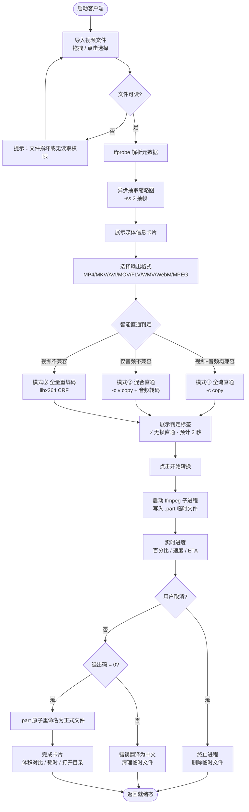
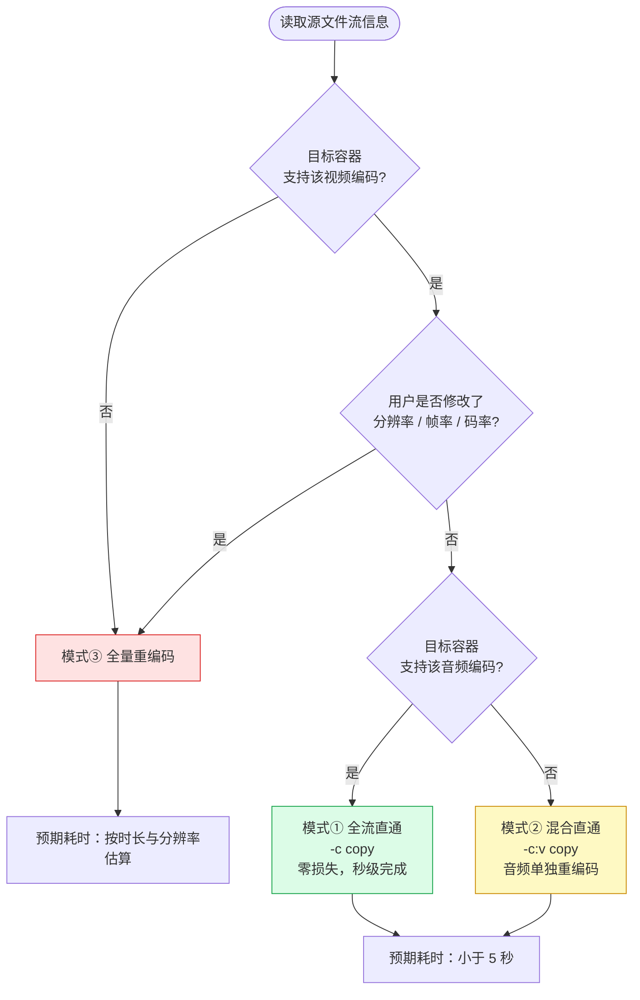
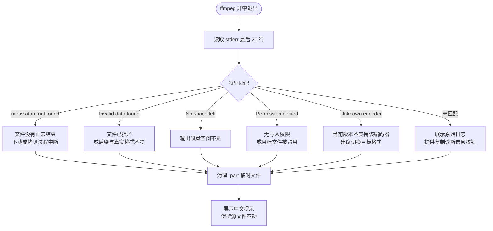
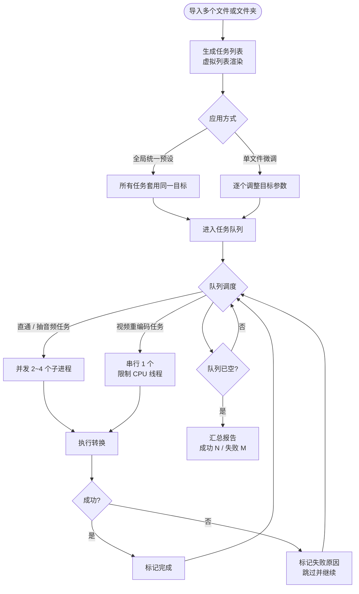

# 视频转换器 · 需求分析文档

> **文档版本**：v1.0（汇总版）
> **编制日期**：2026-07-04
> **产品形态**：桌面 GUI 客户端
> **技术基线**：Electron + React + TypeScript + FFmpeg/FFprobe CLI 子进程
> **适用阶段**：MVP 立项 → 第一版研发 → 后续迭代规划

---

## 文档说明

本文档汇总自两份前期材料：

| 来源 | 内容侧重 | 本文档的处理方式 |
|---|---|---|
| 《视频转换器人工需求分析》 | 原始需求（4 项 MVP + 4 项拓展） | 全部吸收，作为需求基线 |
| 《桌面端智能视频转换器：可行性评估、竞品解构与需求分析（PRD）》 | 竞品拆解、技术路线、FFmpeg 工程细节、F-01~F-09 功能规格 | 全部吸收，但**对 MVP 范围做了收敛**，并把技术栈口径改为已确认的 Electron |

**✅ 技术栈选型结论（已确认，不再变更）**

前期 PRD 论证并推荐 **Tauri 2 + Rust**（核心论据：安装包从 150MB 降到 10MB 级、内存占用 40-80MB、启动秒开）。经综合评估，**本项目最终确认采用 Electron + React + TypeScript**。

> **决策依据**：MVP 的核心风险不在安装包体积，而在「智能直通判定 + 进度解析 + 异常兜底」这套业务逻辑能否快速跑通并被真实验证。Electron 用一套 TypeScript 打通主进程与渲染进程，能把 10 个工作日的工期真正压到 10 个工作日；Tauri 的前后端双语言会显著拉长调试与联调周期。体积与内存的代价，留到上线后根据真实差评再评估。
>
> 下表保留作为**架构决策记录（ADR）**，避免后续重复讨论同一问题。

两种方案在业务逻辑上完全等价，差异只在这几处：

| 环节 | Electron 方案（本文档采用） | Tauri 2 方案（前期 PRD） |
|---|---|---|
| 调 ffmpeg | `child_process.spawn` + 参数数组 | Rust `std::process::Command` / sidecar |
| 进度回传 | 子进程 stdout → IPC → Renderer | 子进程 stdout → Tauri event → 前端 |
| 安装包体积 | 约 90-150MB（Electron 运行时） | 约 8-15MB |
| 内存占用 | 约 150-250MB | 约 40-80MB |
| 开发成本 | 低（一套 TS 打通前后端） | 中（前后端两套语言） |
| 后续迁移成本 | — | 若后期要换，需重写全部后端逻辑（参数规划、进度解析可复用，进程管理需重写） |

**迁移预留**：若上线后「安装包太大 / 内存占用高」成为真实差评点，可评估迁移 Tauri。为此有一条硬约束——**参数规划器 `planConversion()` 必须写成纯函数**（不碰子进程、不碰文件系统、不碰全局状态），迁移时可原样搬走；真正需要重写的只有进程管理与 IPC 层，约占后端代码的 30%。

**实现基线（版本已核对，2026-07-04；详见《开发环境准备清单》）**

| 项 | 选型 | 说明 |
|---|---|---|
| Electron | **44.9.0** | Chromium 152 / Node 24.18.1；支持至 2027-03-02。**不可用 30.x——已于 2024-10-14 EOL** |
| 构建 | electron-vite 6.0.0 + electron-builder 26.15.3 | 三端构建热重载 + Windows NSIS 安装包 |
| 前端 | React 19.3.1 + TypeScript 5.9.3 | TS 弃用 7.x（原生编译器，生态适配待验证） |
| 状态管理 | Zustand 5.0.15 | 任务状态以主进程为唯一真源，渲染层只订阅 |
| 样式 | Tailwind CSS 4.3.3 | v4 无 config 文件，用 `@tailwindcss/vite` 插件 |
| 持久化 | electron-store 12.0.0 | 仅存窗口尺寸、上次输出目录等非敏感配置 |
| 外部二进制 | FFmpeg 8.1.3（GPL full） | 必须 GPL 版，否则缺 libx264/libx265 |
| 安全基线 | `contextIsolation: true`、`nodeIntegration: false`、`sandbox: true`、IPC 白名单 | 渲染进程永不直接接触文件系统与子进程 |

---

## 一、需求背景

### 1.1 要解决的问题

视频文件能否被正常使用，取决于三个互相独立的层次，而普通用户只看得见第一层：

| 层次 | 通俗说法 | 出问题的表现 |
|---|---|---|
| **容器（Container）** | 文件后缀，如 `.mp4` `.mkv` | 设备/软件直接不认这个文件 |
| **编码（Codec）** | 里面的视频/音频用什么算法压的，如 H.264 / HEVC | 后缀是 MP4 但也播不了、导不进剪辑软件 |
| **参数（Parameter）** | 分辨率、帧率、色深、像素格式、码率 | 能播但花屏、音画不同步、上传后糊、体积超标 |

用户遇到"这个视频用不了"时，只会说"格式不对"——**但他猜的原因往往是错的**。真实原因可能只是：文件是 HEVC 编码而剪映不认、是 10bit 色深而 PowerPoint 不认、是可变帧率导致音画不同步、或者文件下载中断导致 moov 原子缺失。

**本项目要解决的，就是把这个"猜错原因 → 反复试错 → 最后放弃"的过程，变成一次成功。**

### 1.2 用户的真实任务（JTBD）

> 当我拍完或收到一个视频，想把它发到某个地方（平台、客户、设备），但系统告诉我"不支持/太大/导不进去"，
> 我需要一个能**告诉我为什么不行**并且**一次就弄对**的工具，
> 这样我就不用反复试错、不用问人、不用担心里面有坑。

这个任务里包含三件事，缺一不可：**诊断**（为什么不行）、**决策**（该选什么）、**保证**（弄完对不对）。

### 1.3 目标用户

| 层级 | 画像 | 占比 | 用的工具 | 付费意愿 | 是否服务 |
|---|---|---|---|---|---|
| A 专业剪辑 | 用 Premiere/达芬奇，懂码率 | 5% | FFmpeg / Shutter Encoder | 极低 | ❌ 放弃 |
| B 技术爱好者 | 知道 HandBrake，会看 MediaInfo | 10% | HandBrake / ShanaEncoder | 极低 | ❌ 放弃 |
| **C 内容创作者** | 拍完要投抖音/B站/小红书，被上传失败或导不进剪映卡住 | **55%** | 剪映自带 / 格式工厂 / 在线网站 | 中（急时愿付费） | ✅ **主战场** |
| **D 办公/家庭** | 老师做课件、销售发产品视频、车载 U 盘、老电视播电影 | **30%** | 微信传 / 格式工厂 / 找人帮转 | 低-中 | ✅ 次战场 |

**产品决策：把 C 层做到极致，D 层顺带覆盖。不为 A/B 层做任何设计——他们不会付钱，还会在评论区说"这功能 HandBrake 早有了"。**

### 1.4 高频真实场景

| # | 场景 | 用户原话 | 真实痛点 | 现有产品表现 |
|---|---|---|---|---|
| 1 | 手机视频导不进剪映 | "提示格式不支持，但我这是 MP4 啊" | HEVC / 10bit / VFR | 差，只给报错 |
| 2 | 视频太大传不上 | "限制 200M，我这个 800M" | 不懂 CRF，只会拉码率滑块 | 中，但会糊 |
| 3 | MKV 电影电视不认 | "下载的电影电视播不了" | 电视只认 MP4 + H.264 | 差，不解释原因 |
| 4 | 竖屏发抖音有黑边 | "上传后被裁切了" | 9:16 + 1080×1920 补边/裁切 | 差，要重剪 |
| 5 | 转完字幕不见了 | "MKV 转 MP4 后中文字幕没了" | 字幕轨在 MP4 里的策略 | 极差 |
| 6 | 大批素材要统一处理 | "200 个片段都要转 1080p" | 队列 + 并发 + 失败重试 | 中 |
| 7 | 上传后画质变糊 | "我传上去就糊了" | 码率不够，平台二次压缩 | 差，**没人告诉他平台会压** |

### 1.5 竞品格局与市场断层

**竞品四象限：**

```
                    免费 ──────────────────────────── 付费
                     │                                  │
        强  ┌────────┼──────────────────────────────────┤
        ↑   │ HandBrake        │  Wondershare UniConverter │
        │   │ Shutter Encoder  │  Movavi Video Converter   │
     能  │   │ FFmpeg CLI       │  Winxvideo / WonderFox    │
     力  │   │ ShanaEncoder     │  AnyMP4                   │
        │   │ 小丸工具箱        │                           │
        │   ├──────────────────┼───────────────────────────┤
        │   │ 格式工厂 ⚠        │  迅捷视频转换器 ⚠⚠        │
        弱  │ VLC              │  风云/金舟/傲软 ⚠⚠        │
            └──────────────────┴───────────────────────────┘
              ⚠ = 体验有争议   ⚠⚠ = 存在大量付费投诉
```

**四个关键竞品的结构性缺陷：**

| 竞品 | 核心优势 | 致命软肋 |
|---|---|---|
| **HandBrake** | 装机 5000 万+，编码参数深，免费纯净 | **不支持视频流直通（Remux）**，官方明确拒绝该功能。MKV→MP4 这类只需换壳的操作也要全量重编码，几秒变几十分钟且损画质；**导出仅支持 MP4/MKV/WebM**，AVI/FLV/WMV/MOV 全不支持 |
| **Shutter Encoder** | 格式最全，有 Rewrap 直通功能 | 界面按广播级后期设计，`Choose function → Editing → Rewrap` 路径隐蔽，小白找不到；无国内平台预设 |
| **格式工厂** | 中文知名度最高，功能大而全 | **捆绑第三方软件，曾被曝植入 BrightData 后台代理程序**（把用户电脑变代理节点）；界面老旧易花屏；诱导付费投诉极多 |
| **Winxvideo / AnyMP4** | 主打 Auto Copy 闪电直通 | 定价昂贵（$30-60），试用版限制严重，营销痕迹重，无国内平台适配 |

**三个结构性断层（这才是机会所在）：**

1. **"能转"和"转对"之间没有产品** —— 所有工具都能把 AVI 转成 MP4，但没有一个能在转之前告诉你"其实不用转，只需换壳"，也没有一个能告诉你"这个结果我验证过了"。用户痛苦的不是转不了，而是**转了三次每次都不一样，不知道哪个是对的**。这是信任问题，从未被解决。
2. **"格式列表"和"我的目的"之间隔着一整个产品** —— 竞品让你选格式→选编码→选分辨率→选码率；用户脑子里只有"我要发抖音"。中间这五步全是产品该替他走完的路，但没人走完。
3. **创作者工作流的上下游没人管** —— 上游（素材导不进剪辑软件）和下游（导出后上传被压糊）两头都在痛点区，没有产品把这条链串起来。

### 1.6 本项目的破局点（三个抓手）

| 抓手 | 破解谁的软肋 | 具体做法 |
|---|---|---|
| **智能流拷贝（Auto Remux）** | HandBrake 强制重编码 | 转前 ffprobe 嗅探编码，兼容就 `-c copy`，秒级完成、零损失 |
| **纯净无广告、零后台驻留** | 格式工厂信任危机 | 全程无网络请求、无捆绑、断网可用，作为可验证的承诺 |
| **本土平台防二压预设** | Shutter Encoder 门槛高、海外工具水土不服 | 抖音/B站/视频号/朋友圈/YouTube 一键预设，含 `-maxrate`/`-bufsize` 抑制二次压缩 |

**一句话定位：**

> **不做第 11 个转换器。我们做"视频交付前的最后一道适配关卡"——你说要发到哪里，我负责让它一定能用，并且证明给你看。**

### 1.7 已确认的产品边界

| 维度 | 结论 | 状态 |
|---|---|---|
| 客户端形态 | 独立桌面 GUI 客户端 | ✅ 已确认 |
| 技术栈 | Electron 44.9.0 + React 19.3.1 + TypeScript 5.9.3（主进程 / 预加载 / 渲染三层） | ✅ 已确认，最终口径 |
| 首发平台 | **Windows 首发**，macOS 二期 | ⚠️ 本文档默认，待拍板 |
| 商业化 | 闭源买断（对应 FFmpeg 合规路径二/三） | ⚠️ 本文档默认，待拍板 |
| 缩略图 | 单帧（第 2 秒或总时长 10% 处） | ✅ 已定 |
| 画幅处理 | MVP 保持原比例，不做横转竖 | ✅ 已定（横转竖放 P2） |
| FFmpeg 引入方式 | 随包分发 + 首次启动自检（GPL 版，仅内部测试）；上架前改路径二/三 | ⚠️ 需在打包前定 |

---

## 二、MVP 最小可行功能点

### 2.1 MVP 的定义

> **一条能完整走完的链路：拖入一个视频 → 看懂它是什么 → 选一个目标格式 → 转出来能播。**

判断标准只有一条：**把软件交给一个不懂技术的朋友，他能自己完成一次转换，不需要你在一旁解释。**

**范围收敛原则**：前期 PRD 定义了 F-01~F-04 四项 P0 功能，其中包含系统右键菜单注册、自定义 URL 协议、系统通知等——这些属于"分发与集成"能力，不是核心链路，且会显著拉长工期。**本文档把它们下沉到 P1，MVP 只保留核心闭环的 6 个模块。**

### 2.2 MVP 功能清单（M-01 ~ M-06）

#### M-01 文件导入

| 项 | 内容 |
|---|---|
| **功能说明** | ① 支持拖拽文件到窗口任意位置；② 支持点击"选择文件"打开系统文件对话框；③ 单文件模式（一次一个） |
| **输入格式** | mp4 / mkv / avi / mov / flv / wmv / webm / mpg / mpeg / m4v / ts（输入放宽，不校验后缀，交给 ffprobe 判定） |
| **交互细节** | 拖入时窗口高亮边框；松手后立即进入解析态；重复拖入替换当前文件 |
| **验收标准** | 拖入 1GB 文件，≤1 秒出现在界面并开始解析；拖入不支持的文件（如 .txt）给出中文提示而非崩溃 |
| **不做** | 文件夹导入、多文件、批量 |

#### M-02 媒体信息解析与缩略图

| 项 | 内容 |
|---|---|
| **功能说明** | ① 调用 ffprobe 解析元数据并结构化展示；② 异步抽帧生成缩略图 |
| **展示字段** | 文件名、文件体积（MB/GB）、总时长（HH:MM:SS）、分辨率（1920×1080）、帧率（FPS）、视频编码（H.264 / HEVC / VP9…）、视频码率（kbps）、音频编码与声道与采样率、音轨数量、字幕轨数量 |
| **缩略图策略** | 优先 `-ss 2` 抽帧；若 2 秒处为黑屏或失败，退回 `-ss 0`；仍失败则显示占位图。尺寸 320px 宽，等比 |
| **关键技术点** | `-ss` 必须放在 `-i` 之前（输入寻址），否则会从头解码导致极慢 |
| **验收标准** | 元数据 ≤500ms 显示（不含缩略图）；缩略图 ≤1.5s 出现；纯音频文件或损坏文件显示占位图 + 明确原因提示 |
| **不做** | 多帧预览条、波形图、详细编码参数（profile/level/色彩空间） |

#### M-03 输出目标选择与智能直通判定

| 项 | 内容 |
|---|---|
| **功能说明** | ① 提供 8 种输出容器选择；② 自动判定能否"无损直通"，并明确告知用户 |
| **输出容器** | MP4 / MKV / AVI / MOV / FLV / WMV / WebM / MPEG |
| **三种执行模式** | **① 全流直通**：视频+音频编码都被目标容器支持 → `-c copy`<br>**② 混合直通**：视频兼容、音频不兼容 → `-c:v copy -c:a <目标编码>`<br>**③ 全量重编码**：视频不兼容 → 走标准编码参数 |
| **判定依据** | 内置「容器-编码兼容矩阵」（见附录 B）+ 「用户是否修改了分辨率/帧率/码率」 |
| **UI 呈现** | 判定结果以醒目标签展示：`⚡ 无损直通 · 预计 3 秒 · 画质 100% 保留` 或 `重编码 · 预计 8 分钟 · H.264 CRF 20`。**这是产品的核心差异点，必须让用户看见** |
| **各容器默认编码** | MP4→`libx264 + aac`；MKV→`libx264 + aac`；AVI→`mpeg4 + mp3`；MOV→`libx264 + aac`；FLV→`libx264 + aac`；WMV→`wmv2 + wmav2`；WebM→`libvpx-vp9 + libopus`；MPEG→`mpeg2video + mp2` |
| **验收标准** | ① MKV(H.264+AAC)→MP4 判定为「全流直通」，1GB 文件 ≤5 秒完成；② AVI(XviD)→MP4 判定为「全量重编码」；③ MKV(H.264+DTS)→MP4 判定为「混合直通」；④ 切换输出格式时标签实时刷新 |
| **不做** | 平台预设卡片、自定义编码器/CRF/preset 暴露 |

#### M-04 转码执行 · 实时进度 · 可取消

| 项 | 内容 |
|---|---|
| **功能说明** | ① 以子进程方式调用 ffmpeg；② 实时解析进度；③ 随时取消 |
| **进程调用规范** | 必须用 `spawn(ffmpegPath, argArray, { shell: false, windowsHide: true })`——**严禁字符串拼接 + shell:true**（中文路径、空格、括号会炸，且有命令注入风险） |
| **进度解析** | 使用 `-progress pipe:1 -nostats` 获取结构化输出，解析 `out_time_us` 与 `speed`；进度 = 已处理时长 / 总时长。**不要解析 stderr 的人类可读文本**（格式会变、有缓冲） |
| **进度节流** | IPC 推送间隔 ≥500ms，避免高频事件卡死渲染进程 |
| **展示内容** | 百分比进度条、已处理时长/总时长、速度倍率（如 2.4x）、预估剩余时间（ETA） |
| **取消机制** | 发送终止信号 → 等待退出 → 删除临时文件 → 回到就绪态 |
| **验收标准** | ① 进度单调递增，与实际偏差 <2%；② 转码期间界面可正常操作，不卡死；③ 点取消后 1 秒内进程消失，无孤儿进程，临时文件被清理 |
| **不做** | 暂停/恢复、断点续转、并发多任务 |

#### M-05 输出落盘与完成反馈

| 项 | 内容 |
|---|---|
| **写入策略** | **先写 `输出名.part` 临时文件，成功后原子重命名为正式文件**。任何失败路径都删除 `.part`，绝不留半截文件 |
| **输出路径** | 默认输出到源文件同级目录，文件名追加 `_converted` 后缀（如 `旅行.mkv` → `旅行_converted.mp4`），**绝不覆盖源文件**；允许用户在 MVP 里手动改输出目录（简单目录选择器） |
| **完成卡片** | 展示：输出文件名、输出体积、源体积与压缩比、耗时、模式标签（直通/重编码）、`打开所在文件夹` 按钮 |
| **验收标准** | ① 源文件始终不被修改；② 同名文件已存在时自动加序号而非覆盖；③ 输出文件在 VLC 与系统播放器中音画同步正常 |
| **不做** | 系统通知、批量结果汇总、自动打开播放器 |

#### M-06 异常兜底与错误翻译

| 项 | 内容 |
|---|---|
| **功能说明** | 捕获 ffmpeg 非零退出码与 stderr，转换为可操作的中文提示 |
| **必覆盖的 5 类错误** | ① `moov atom not found` → 文件没有正常结束（下载/拷贝中断），无法转换<br>② `Invalid data found when processing input` → 文件损坏，或后缀与真实格式不符<br>③ `No space left on device` → 输出盘空间不足<br>④ `Permission denied` → 无写入权限，或目标文件正被其他程序占用<br>⑤ `Unknown encoder` → 当前 FFmpeg 不支持该编码器，已建议切换目标格式 |
| **兜底策略** | 未匹配到规则时，展示 stderr 最后 20 行 + 「复制诊断信息」按钮 |
| **清理策略** | 任何失败都删除 `.part` 临时文件；进程异常退出时也要清理 |
| **验收标准** | ① 故意放入一个改后缀的假 MP4，给出中文原因而非原始堆栈；② 转码中途拔掉 U 盘或磁盘写满，程序不崩溃且给出正确提示；③ 错误信息可一键复制 |
| **不做** | 自动错误上报、崩溃日志收集 |

### 2.3 MVP 明确不做的事（写进范围，防止跑偏）

| 不做 | 原因 |
|---|---|
| ❌ 批量队列 / 文件夹导入 | 属于扩展能力，会把状态管理复杂度抬高一档 |
| ❌ 系统右键菜单 / 自定义 URL 协议 | 涉及安装器、注册表、macOS 权限，工期不可控 |
| ❌ 硬件加速（NVENC/QSV/AMF） | MVP 用 `libx264 -preset veryfast` 足够跑通；探测+降级矩阵放 P1 |
| ❌ 平台预设卡片（抖音/B站） | 需要逐平台验证码率规则，MVP 阶段无法闭环 |
| ❌ 视频转音频 | 独立功能线，不影响主链路验证 |
| ❌ 分辨率缩放 | 成本极低但会引入"缩放后是否还算直通"的判定分支，先砍 |
| ❌ 目标体积 Two-Pass | 最复杂的一块，放 P2 |
| ❌ 输出校验（SSIM/解码验证） | 用人工验收替代 |
| ❌ 设置页 / 主题 / 多语言 | 非核心 |
| ❌ 自动更新 / 授权付费 | 上线后再说 |

### 2.4 MVP 完成标准（Definition of Done）

同时满足以下 7 条，MVP 才算完成：

- [ ] 8 种容器两两互转（56 种组合）全部能产出可播放文件
- [ ] MKV(H.264+AAC)→MP4 走直通，1GB 文件 ≤5 秒
- [ ] 进度条真实反映转码进度，偏差 <2%
- [ ] 取消后无残留进程、无残留临时文件
- [ ] 中文路径 / 含空格 / 含括号的文件名全部正常
- [ ] 5 类典型错误均给出中文提示
- [ ] 打包成安装包，在**一台从未装过开发环境的干净 Windows 机器**上可直接运行（ffmpeg 随包分发或首启自检）

### 2.5 工期估算

| 阶段 | 内容 | 预估 |
|---|---|---|
| 0 | 脚手架（Electron + Vite + React + TS）、IPC 通道、ffmpeg 二进制打包 | 1.5 天 |
| 1 | M-01 文件导入 + M-02 元数据与缩略图 | 2 天 |
| 2 | M-03 兼容矩阵 + 直通判定 + 参数规划器 | 1.5 天 |
| 3 | M-04 转码执行 + 进度 + 取消 | 2 天 |
| 4 | M-05 落盘 + 完成卡片 + M-06 错误翻译 | 1.5 天 |
| 5 | 联调、56 种组合回归、打包、干净机测试 | 1.5 天 |
| | **合计** | **约 10 个工作日（2 周）** |

> **关键工程建议**：把「参数规划器」写成**纯函数**（输入：源元数据 + 目标格式 + 用户改动 → 输出：ffmpeg 参数数组 + 模式标签 + 预估信息），它不碰进程、不碰文件系统。这样能单测、能复用到 Tauri 版本、也是最容易出 bug 的地方。

---

## 三、后续扩展功能点（含优先级）

### 3.1 优先级定义

| 级别 | 含义 | 判断依据 |
|---|---|---|
| **P1** | MVP 之后立刻做，构成第一版完整产品 | 高频需求 或 低成本高感知 |
| **P2** | 建立技术壁垒，形成差异化 | 竞品普遍缺失 或 技术含量高 |
| **P3** | 商业化与规模化，长线布局 | 需要用户基数或企业客户支撑 |

### 3.2 P1 —— 第一版完整产品（MVP + 4~6 周）

| 编号 | 功能 | 说明 | 为什么是 P1 |
|---|---|---|---|
| **P1-01** | 分辨率缩放 | 4K/2K/1080P/720P/480P 或保持原样。用 `scale=-2:720`（横屏）/ `scale=720:-2`（竖屏），`-2` 保证另一边为偶数，规避 libx264 奇数像素报错 | 实现成本极低（一个 `-vf`），需求频率极高 |
| **P1-02** | 视频转音频 | 提取 MP3 / WAV / AAC / FLAC / Opus。源为 AAC 且目标为 m4a 时走 `-vn -c:a copy` 秒出；支持多音轨选择（`-map 0:a:N`） | 成本低，能覆盖播客/听课/提取 BGM 场景 |
| **P1-03** | 硬件加速自动探测与降级 | 启动时实跑 0.5 秒空转编码测试（`-f lavfi -i color=...`）判断可用性；顺序 NVENC → QSV → AMF → CPU；运行失败自动降级重试 | 直接把长视频转码从 10 分钟压到 30 秒，是**最强的付费理由** |
| **P1-04** | 平台预设卡片 | 抖音 / B站（双档）/ 视频号 / 朋友圈 / 小红书 / YouTube。内置分辨率+码率+`-maxrate`+`-bufsize`+`-pix_fmt yuv420p`+`faststart` | 核心差异化，直接对应"防二压"焦虑 |
| **P1-05** | 批量队列 | 多文件/文件夹导入、虚拟列表、统一预设 + 单文件微调、失败跳过、完成汇总 | 创作者真实工作流刚需；需配合并发调度（直通 2-4 并发，重编码串行） |
| **P1-06** | 输出校验徽章 | 转完自动 `ffprobe` 比对时长/流数量，并抽样解码首尾各 5 秒；通过打绿标 `✓ 已验证可播放` | 把产品承诺变成可验证事实，竞品无一家做 |
| **P1-07** | 系统集成 | Windows 右键菜单、自定义协议 `videoconv://`、完成后系统通知、打开输出目录 | 对应原始需求"必须跟客户端关联"的完整形态 |

### 3.3 P2 —— 技术壁垒与差异化（第二版）

| 编号 | 功能 | 说明 | 壁垒点 |
|---|---|---|---|
| **P2-01** | 目标体积精准压缩（Two-Pass） | 用户输入目标 MB，反推码率：`视频码率 = (目标MB×8192/时长秒) × 0.98 - 音频码率`；强制两遍编码；Pass1 映射 0-40%，Pass2 映射 40-100%；完成后清理 `.log`/`.mbtree` | 单遍编码实测会超标约 20%，两遍可把误差压到 0.13%。工程含金量高 |
| **P2-02** | 横转竖屏（模糊背景填充） | 横屏 16:9 → 竖屏 9:16，用 `split + boxblur + overlay` 生成模糊背景垫底，画面不变形 | 抖音/视频号创作者刚需，竞品几乎都没做对 |
| **P2-03** | 字幕与多音轨策略器 | MKV→MP4 时明确询问：保留为可开关字幕 / 烧录进画面 / 丢弃；音轨选择默认轨 | 高频投诉点（"转完字幕没了"），HandBrake 有能力但藏得深 |
| **P2-04** | 监控文件夹自动转换 | 绑定 OBS 录制目录，新文件落盘后自动换壳为可剪辑 MP4 | 工作流自动化，专业用户粘性极强 |
| **P2-05** | 转码前后对比 | 同帧并排对比 + SSIM/VMAF 分数 + 体积变化 | 视觉冲击力强，适合做产品演示与口碑传播 |
| **P2-06** | 预设远程更新 | 平台码率规则可远程下发（做成"可选联网更新"） | 平台规则会变，这是长期维护的必要机制 |

### 3.4 P3 —— 商业化与规模化

| 编号 | 功能 | 说明 |
|---|---|---|
| **P3-01** | 授权与付费体系 | 买断制授权码、设备绑定、离线激活（避免强制联网） |
| **P3-02** | 命令行 / 静默批处理模式 | 给 MCN、电商、培训机构做批量处理，企业版核心卖点 |
| **P3-03** | 自动更新 | 增量更新 + 回滚 |
| **P3-04** | 国际化 | 英文 UI + 海外定价（$19.99 买断），打开海外市场 |
| **P3-05** | macOS 版本 | 需签名 + 公证（Apple Developer $99/年），VideoToolbox 硬件编码 |

### 3.5 免费 / 付费分层建议

**核心原则：免费版必须够用（否则打不过 HandBrake），付费版卖的是"省时间"而不是"解锁功能"。**

| 能力 | 免费版 | Pro（买断） |
|---|---|---|
| 单文件转换 | ✅ 无限次、无时长限制、无水印 | ✅ |
| 智能直通 | ✅ | ✅ |
| 元数据 + 缩略图 | ✅ | ✅ |
| 平台预设卡片 | ✅ 全部 | ✅ |
| **硬件加速** | ❌ 仅 CPU | ✅ |
| **批量队列** | ❌ 一次 1 个 | ✅ 无限 |
| **目标体积压缩** | ❌ | ✅ |
| **横转竖 / 字幕策略** | ❌ | ✅ |
| **监控文件夹** | ❌ | ✅ |
| 输出校验报告 | 基础 | 完整 |

> 把"硬件加速"放进付费是有意为之：它不是功能，是**时间**。免费用户等 10 分钟，付费用户等 30 秒——最容易让人掏钱的差异，且边际成本为零。

**定价参考**：国内 ￥68 买断（首发 ￥39）；海外 $19.99 买断；企业版 ￥499-1999/年。

### 3.6 明确永远不做

| 功能 | 原因 |
|---|---|
| AI 超分辨率 / 画质增强 | 模型体积大、GPU 依赖强、效果不稳、用户预期错位 |
| 视频剪辑 / 时间轴 | 直接和剪映竞争，必输 |
| 云转码 | 服务器成本 + 隐私风险，本地转码是唯一成本优势 |
| DRM 解密 / 加密视频 | 法律风险 |
| 在线视频下载 | 版权风险，且是另一条赛道 |
| 支持 1000 种格式 | 交互灾难，克制是竞争力 |

---

## 四、用户操作流程图（Mermaid）

### 4.1 MVP 主流程



### 4.2 智能直通判定子流程（核心算法）



### 4.3 异常处理决策树



### 4.4 扩展期批量流程（P1-05 参考）



---

## 五、需求功能核对清单（Task 列表）

> 使用说明：每完成一项勾选一项。带 ⭐ 的是**不可省略项**（省掉会导致产品闭环断裂）。

### 阶段 0 · 工程脚手架

- [ ] ⭐ 初始化 Electron + Vite + React + TypeScript 工程
- [ ] ⭐ 配置主进程 / 预加载脚本 / 渲染进程三层结构，启用 `contextIsolation`，禁用 `nodeIntegration`
- [ ] ⭐ 定义 IPC 白名单通道：`probe` / `thumbnail` / `convert:start` / `convert:cancel` / `convert:progress` / `openFolder`
- [ ] 打包 ffmpeg.exe + ffprobe.exe 至 resources 目录，实现开发态与打包态的路径解析
- [ ] 启动自检：检测 ffmpeg 是否可执行，失败时给出明确引导
- [ ] 配置 electron-builder，产出 Windows 安装包

### 阶段 1 · M-01 文件导入

- [ ] ⭐ 窗口级拖拽（`dragover` / `drop`），拖入时高亮边框
- [ ] ⭐ 文件选择对话框（限制视频扩展名过滤）
- [ ] 单文件替换逻辑（重复拖入覆盖当前）
- [ ] 不支持类型的拦截与中文提示
- [ ] 超长路径 / 中文路径 / 含空格路径的传递测试

### 阶段 2 · M-02 元数据与缩略图

- [ ] ⭐ `ffprobe -v quiet -print_format json -show_format -show_streams` 封装为 `probeMedia()`
- [ ] ⭐ 解析并映射字段：体积、时长、分辨率、帧率、视频编码、视频码率、音频编码/声道/采样率、音轨数、字幕轨数
- [ ] ⭐ 缩略图命令 `-ss 2 -i xxx -frames:v 1 -vf scale=320:-2`，`-ss` 必须在 `-i` 之前
- [ ] 缩略图降级链：`-ss 2` → `-ss 0` → 占位图
- [ ] 纯音频文件 / 无视频流文件的优雅处理
- [ ] 把缩略图转成可被渲染进程加载的 URL（自定义协议或 data URL）
- [ ] 性能验证：元数据 ≤500ms，缩略图 ≤1.5s

### 阶段 3 · M-03 直通判定与参数规划

- [ ] ⭐ 内置「容器-编码兼容矩阵」数据结构（参考附录 B）
- [ ] ⭐ 实现 `planConversion(sourceMeta, targetFormat, userOverrides)` **纯函数**，返回 `{ args, mode, warnings, estimate }`
- [ ] ⭐ 三种模式判定：全流直通 / 混合直通 / 全量重编码
- [ ] ⭐ 各容器默认编码器映射（见 M-03 表格）
- [ ] 模式标签 UI（直通=绿色，混合=黄色，重编码=红色）
- [ ] 预估耗时与预估体积的粗略计算
- [ ] 为 `planConversion` 编写单元测试，覆盖 8 种容器 × 3 种源编码的典型组合

### 阶段 4 · M-04 转码引擎

- [ ] ⭐ `spawn(ffmpeg, args, { shell: false, windowsHide: true })`，参数以数组传递
- [ ] ⭐ 使用 `-progress pipe:1 -nostats`，解析 `out_time_us` 与 `speed`
- [ ] ⭐ 进度 = 已处理时长 / 总时长，IPC 推送节流 ≥500ms
- [ ] ⭐ 取消：终止进程 → 等待退出 → 清理临时文件
- [ ] 处理 `out_time_ms`（实际单位是微秒）的版本兼容
- [ ] ETA 计算与展示（速度倍率、剩余时间）
- [ ] 验证：转码期间界面不卡死；取消后无孤儿进程

### 阶段 5 · M-05 输出与完成反馈

- [ ] ⭐ 先写 `.part` 再原子重命名，所有失败路径删除 `.part`
- [ ] ⭐ 默认输出到源目录，追加 `_converted` 后缀，绝不覆盖源文件
- [ ] 同名文件自动加序号（`_converted_1`、`_converted_2`）
- [ ] 输出目录选择器
- [ ] 完成卡片：体积对比、耗时、模式标签、打开文件夹按钮
- [ ] 验证：源文件 md5 转换前后一致

### 阶段 6 · M-06 异常兜底

- [ ] ⭐ stderr 捕获 + 5 类错误规则匹配（moov 缺失 / 无效数据 / 磁盘满 / 权限 / 编码器缺失）
- [ ] ⭐ 未匹配时展示最后 20 行 + 复制诊断按钮
- [ ] ⭐ 所有失败路径清理临时文件
- [ ] 磁盘写满场景实测
- [ ] 假后缀文件（.txt 改名 .mp4）实测
- [ ] 转码中途拔盘 / 目标文件被占用的实测

### 阶段 7 · 验收与交付

- [ ] ⭐ 8 种容器两两互转，56 种组合回归测试并记录结果
- [ ] ⭐ MKV(H.264+AAC)→MP4 直通实测 ≤5 秒（1GB 文件）
- [ ] ⭐ 在干净 Windows 机器（无 Node / 无 ffmpeg）安装并跑通全流程
- [ ] 杀毒软件误报检查（360 / 火绒 / Defender）
- [ ] 界面文案校对（不出现 FFmpeg 术语、CRF、编解码器型号等黑话）
- [ ] 准备产品截图与 30 秒演示视频

### P1 待启动（MVP 验收通过后）

- [ ] P1-01 分辨率缩放（`scale=-2:720`，偶数对齐）
- [ ] P1-02 视频转音频（MP3/WAV/AAC/FLAC/Opus + 多音轨选择）
- [ ] P1-03 硬件加速探测（空转编码测试）与降级回退
- [ ] P1-04 平台预设卡片（抖音 / B站双档 / 视频号 / 朋友圈 / 小红书 / YouTube）
- [ ] P1-05 批量队列（虚拟列表 + 并发调度 + 失败跳过 + 汇总）
- [ ] P1-06 输出校验徽章（时长/流比对 + 抽样解码）
- [ ] P1-07 系统集成（右键菜单 / `videoconv://` / 通知）

### P2 待规划

- [ ] P2-01 目标体积 Two-Pass 压缩
- [ ] P2-02 横转竖屏（模糊背景填充）
- [ ] P2-03 字幕与多音轨策略器
- [ ] P2-04 监控文件夹自动转换
- [ ] P2-05 转码前后对比（SSIM/VMAF）
- [ ] P2-06 预设远程更新机制

### P3 待评估

- [ ] P3-01 授权与付费体系
- [ ] P3-02 命令行 / 静默批处理
- [ ] P3-03 自动更新
- [ ] P3-04 国际化与海外发行
- [ ] P3-05 macOS 版本（签名 + 公证）

---

## 附录

### A. FFmpeg 命令速查

```bash
# 1. 元数据解析
ffprobe -v quiet -print_format json -show_format -show_streams "input.mkv"

# 2. 缩略图（注意 -ss 在 -i 之前，走输入寻址，毫秒级）
ffmpeg -ss 00:00:02 -i "input.mp4" -frames:v 1 -vf "scale=320:-2" -q:v 2 -y "thumb.jpg"

# 3. 无损换壳 Remux（核心差异点）
ffmpeg -y -i "input.mkv" -map 0 -c copy -movflags +faststart "output.mp4"

# 4. 混合直通（视频 copy，仅音频转码）
ffmpeg -y -i "input.mkv" -map 0 -c:v copy -c:a aac -b:a 192k -movflags +faststart "output.mp4"

# 5. 常规重编码（CRF 模式，画质优先）
ffmpeg -y -i "input.avi" -c:v libx264 -preset veryfast -crf 20 \
  -pix_fmt yuv420p -c:a aac -b:a 128k -movflags +faststart "output.mp4"

# 6. 带结构化进度（MVP 必用）
ffmpeg -y -i "input.mkv" -c copy -progress pipe:1 -nostats "output.mp4"

# 7. 分辨率缩放（-2 保证偶数，避免 libx264 报错）
ffmpeg -y -i "input.mp4" -vf "scale=-2:720" -c:v libx264 -crf 23 -c:a copy "out_720p.mp4"

# 8. 音频提取
ffmpeg -y -i "in.mp4" -vn -c:a libmp3lame -b:a 192k "out.mp3"
ffmpeg -y -i "in.mp4" -vn -c:a copy "out.m4a"          # 源为 AAC 时秒出

# 9. 硬件加速（P1）
ffmpeg -y -i "in.mov" -c:v h264_nvenc -preset p5 -rc vbr -cq 22 -c:a aac "out.mp4"
ffmpeg -y -i "in.mov" -c:v h264_qsv   -global_quality 23 -c:a aac "out.mp4"

# 10. 硬件编码器可用性实测（P1，比 -encoders 列表可靠）
ffmpeg -f lavfi -i color=c=black:s=256x256:d=0.5 -c:v h264_nvenc -f null -

# 11. 目标体积两遍编码（P2）
ffmpeg -y -i "in.mp4" -c:v libx264 -b:v 1450k -pass 1 -passlogfile "job1" -an -f null NUL
ffmpeg -y -i "in.mp4" -c:v libx264 -b:v 1450k -pass 2 -passlogfile "job1" -c:a aac -b:a 128k "out.mp4"
```

### B. 容器 - 编码兼容矩阵（规划器核心数据）

**视频编码：**

| 容器 | H.264 | HEVC | AV1 | VP9 | MPEG-4 | WMV3/VC-1 | MPEG-2 |
|---|---|---|---|---|---|---|---|
| MP4 | ✅ | ✅ | ✅ | △ | ✅ | ❌ | △ |
| MKV | ✅ | ✅ | ✅ | ✅ | ✅ | ✅ | ✅ |
| WebM | ❌ | ❌ | ✅ | ✅ | ❌ | ❌ | ❌ |
| MOV | ✅ | ✅ | △ | ❌ | ✅ | ❌ | △ |
| AVI | ✅ | △ | ❌ | ❌ | ✅ | ✅ | ✅ |
| FLV | ✅ | ❌ | ❌ | ❌ | ❌ | ❌ | ❌ |
| WMV | ❌ | ❌ | ❌ | ❌ | ❌ | ✅ | ❌ |
| MPEG | ❌ | ❌ | ❌ | ❌ | △ | ❌ | ✅ |

**音频编码：** MP4 支持 AAC / MP3 / AC3 / ALAC（Opus 需较新版本）；MKV 几乎全支持；WebM 仅 Opus / Vorbis；AVI 常用 MP3 / AC3；FLV 仅 AAC / MP3；WMV 仅 WMA；MPEG 常用 MP2。

`✅ 可直通`　`△ 有条件（版本/参数）`　`❌ 必须重编码`

**高频直通场景（必须做到秒转）：**

| 源 → 目标 | 结果 |
|---|---|
| MKV(H.264+AAC) → MP4 | ✅ 全流直通 |
| FLV(H.264+AAC) → MP4 | ✅ 全流直通（B站老视频） |
| MOV(H.264) → MP4 | ✅ 全流直通（iPhone 素材） |
| TS/M2TS(H.264) → MP4 | ✅ 全流直通（录屏、直播回放） |
| MP4 → MKV | ✅ 全流直通 |
| MKV(H.264+DTS) → MP4 | ⚠️ 混合直通（视频 copy，音频转 AAC） |
| WMV → 任意现代容器 | ❌ 必须重编码 |
| AVI(XviD/DivX) → MP4 | ❌ 建议重编码（技术上可 copy，但兼容性差） |

### C. 术语对照（UI 文案禁用黑话）

| 技术术语 | 面向用户的说法 |
|---|---|
| Container / 容器 | 文件格式 |
| Codec / 编码 | 视频内部格式（尽量不出现） |
| Remux / 流拷贝 | 无损换壳 / 不重新压缩 |
| Transcode / 转码 | 重新压缩 |
| CRF | 画质档位 |
| Bitrate / 码率 | 清晰度（数值不暴露给普通用户） |
| Pixel format / yuv420p | 兼容性格式（内部固定，不暴露） |
| faststart | （不暴露，默认开启） |

### D. 待确认事项

| # | 事项 | 备选 | 影响 |
|---|---|---|---|
| 1 | ~~技术栈最终口径~~ | **已关闭：Electron + React + TypeScript** | 见文首选型结论与 ADR 对照表 |
| 2 | 首发平台 | 仅 Windows ／ Windows + macOS | macOS 需签名公证（$99/年），工期 +1~2 周 |
| 3 | 商业化模式 | 闭源买断 ／ 完全开源（GPLv3） | 直接决定 FFmpeg 分发合规路径 |
| 4 | FFmpeg 引入方式 | 随包分发 ／ 首启引导用户用 winget/brew 安装 ／ 只调硬件编码器的纯 LGPL 版 | 影响安装包体积与上架合规 |
| 5 | 代码签名证书 | 买 ／ 不买 | 直接影响杀软误报率与下载转化 |
| 6 | 项目时间预算 | 2 周 MVP ／ 6 周完整版 | 决定范围取舍 |

### E. 合规提示（不可忽略）

FFmpeg 核心为 LGPLv2.1+，但启用 `--enable-gpl`（含 libx264 / libx265）后整个二进制受 GPL 约束；同时启用 `--enable-nonfree`（如 fdk-aac）则**禁止向公众分发**。

三条可行路径：

1. **完全开源**（GPLv3 发布，可随包分发 GPL 版 ffmpeg，严禁 nonfree）
2. **外部按需安装**（客户端闭源，首启引导用户通过 winget / brew 自行安装 ffmpeg，仅通过命令行调用）—— **最推荐独立商业化采用**
3. **纯 LGPL 动态链接**（自编译不含 GPL 组件的版本，只能调系统/显卡原生硬件编码器，需履行 LGPL 署名与源码提供义务）

无论哪条路径，都必须在「关于」页与 EULA 中声明使用 FFmpeg，并移除 EULA 中禁止逆向工程的条款。

---

**文档结束**
